<div align="center">
# Prak_PBW_A_Railene_24081

# "PRAKTIKUM PBW – A"

*"Disusun Untuk Memenuhi Tugas Mata Kuliah Praktikum PBW A"*

<br>

<br>  <br>

<br>

**Disusun Oleh**

Railene Akbillah Ramadhan Haryanto - 4524210081

**Dosen Pengampu**

Bambang Riono Arsad, S.Kom., MMSI

<br>

### PROGRAM STUDI TEKNIK INFORMATIKA
### UNIVERSITAS PANCASILA
### 2026-2027

</div>

---

## Daftar Isi

- [Pertemuan 1 dan 2](#pertemuan-1-dan-2-tugas-1-dan-2)
  - [Cara Install](#cara-install)
  - [1. Menjalankan Ulang Contoh Pertemuan 1](#1-menjalankan-ulang-contoh-pertemuan-1)
  - [2. Modifikasi Program Minimal 2](#2-modifikasi-program-minimal-2)
  - [3. Penjelasan Bagian Kode yang Paling Penting](#3-penjelasan-bagian-kode-yang-paling-penting)
  - [4. Tampilan Sebelum dan Sesudah Modifikasi](#4-tampilan-sebelum-dan-sesudah-modifikasi)
  - [5. Error yang Pernah Muncul](#5-error-yang-pernah-muncul)
- [Pertemuan 3](#pertemuan-3)
  - [1. Cara Install Laravel](#1-cara-install-laravel)
  - [2. Tugas yang Dikerjakan](#2-tugas-yang-dikerjakan)
  - [3. Fitur-Fitur Utama](#3-fitur-fitur-utama)
  - [4. Hasil Foto Tugas 3](#4-hasil-foto-tugas-3)
- [Pertemuan 4](#pertemuan-4)
  - [1. Cara Install](#1-cara-install)
  - [2. Tugas yang Dikerjakan](#2-tugas-yang-dikerjakan-1)
  - [3. Fitur-Fitur Utama](#3-fitur-fitur-utama-1)
  - [4. Hasil Foto Tugas 4](#4-hasil-foto-tugas-4)
- [Pertemuan 5](#pertemuan-5)
  - [1. Cara Install](#1-cara-install-1)
  - [2. Tugas yang Dikerjakan](#2-tugas-yang-dikerjakan-2)
  - [3. Fitur-Fitur Utama](#3-fitur-fitur-utama-2)
  - [4. Hasil Foto Tugas](#4-hasil-foto-tugas)
- [Pertemuan 6](#pertemuan-6)
  - [6.1 Cara Install dan Menjalankan](#61-cara-install-dan-menjalankan)
  - [6.2 Tugas 1: Implementasi Dasar](#62-tugas-1-implementasi-dasar)
  - [6.3 Tugas 2: Kustomisasi dan Pengembangan](#63-tugas-2-kustomisasi-dan-pengembangan)
    - [6.3.1 Field Description pada Book](#631-field-description-pada-book)
    - [6.3.2 Role-Based Access](#632-role-based-access)
    - [6.3.3 Widget Dashboard](#633-widget-dashboard)
    - [6.3.4 Kategori Buku](#634-kategori-buku)
  - [6.4 Tugas 3: Analisis dan Dokumentasi](#64-tugas-3-analisis-dan-dokumentasi)
    - [6.4.1 Penjelasan Arsitektur](#641-penjelasan-arsitektur)
    - [6.4.2 Perbandingan dengan Pendekatan Tradisional](#642-perbandingan-dengan-pendekatan-tradisional)
    - [6.4.3 Refleksi Pembelajaran](#643-refleksi-pembelajaran)
- [📂 Panduan Git & GitHub](./panduan/)

---

# Pertemuan 1 dan 2 (Tugas 1 dan 2)

Materi: dasar PHP, client-server, dan HTTP method (GET dan POST), dengan dua contoh program (`kalkulator.php` dan `biodata.php`).

Ketentuan Tugas 1:

1. Menjalankan seluruh contoh Pertemuan 1 hingga menghasilkan output tanpa error kritis.
2. Membuat minimal dua modifikasi bermakna pada program.
3. Menuliskan penjelasan singkat untuk lima bagian kode yang paling penting.
4. Menyertakan screenshot sebelum dan sesudah modifikasi.
5. Menuliskan satu error yang pernah muncul, penyebabnya, dan langkah perbaikannya.

File yang dikerjakan (folder [`Prak1`](Prak1)):

| File | Keterangan |
| --- | --- |
| `kalkulator.php` | Contoh asli kalkulator (hitung sekali) |
| `biodata.php` | Contoh asli biodata mahasiswa |
| `Kalkulator_Tugas1.php` | Kalkulator hasil modifikasi |
| `biodata_tugas1.php` | Biodata hasil modifikasi |

## Cara Install

### Kebutuhan

| Kebutuhan | Keterangan |
| --- | --- |
| PHP | Versi 8.2 ke atas |
| Web server dan database | Apache dan MySQL/MariaDB (lewat XAMPP atau Laragon) |
| Composer | Dependency manager untuk PHP |
| Code editor | Visual Studio Code |

Praktikum ini dikerjakan di Windows dengan Laragon. XAMPP bisa dipakai sebagai alternatif sesuai modul praktikum.

### 1. Install XAMPP

1. Download installer `.exe` XAMPP, lalu install di laptop. Boleh di `C:/` atau `D:/`, tetapi disarankan di `C:/`.
2. Buka terminal/CMD, ketik `php -v`. Kalau versi PHP muncul, berarti PHP sudah terbaca.
3. Kalau belum terbaca, buka **Environment Variables** lewat pencarian Windows (ketik `env`).
4. Pada bagian **Path**, klik **Edit**, klik **New**, lalu tulis `C:\xampp\php`.
5. Klik **New** lagi, lalu tulis `C:\xampp\mysql\bin`.
6. Klik **OK** sampai semua jendela tertutup.
7. Tutup terminal lama, buka terminal baru, lalu ketik `php -v` untuk mengecek.

### 2. Install Composer

1. Download installer Composer, lalu install di laptop.
2. Saat diminta lokasi `php.exe`, arahkan ke `C:\xampp\php\php.exe`.
3. Lanjutkan dengan **Next** sampai proses install selesai.
4. Buka terminal baru, lalu ketik `composer -V`.
5. Kalau versi Composer muncul, berarti Composer sudah siap dipakai. Kalau belum terbaca, tutup terminal lama dan buka lagi, lalu cek ulang.

### 3. Ambil Project dari GitHub

```bash
git clone https://github.com/Raizero0/Prak_PBW_A_Railene_24081.git
```

Simpan folder hasil clone di folder root web server:

| Aplikasi | Lokasi folder |
| --- | --- |
| Laragon | `C:\laragon\www\` |
| XAMPP | `C:\xampp\htdocs\` |

### 4. Jalankan Program

1. Jalankan **Apache** (Laragon: klik **Start All**, XAMPP: klik **Start** pada Apache).
2. Buka browser, lalu akses salah satu alamat berikut.

| Program | Alamat |
| --- | --- |
| Kalkulator (asli) | `http://localhost/Prak_PBW_A_Railene_24081/Prak1/kalkulator.php` |
| Biodata (asli) | `http://localhost/Prak_PBW_A_Railene_24081/Prak1/biodata.php` |
| Kalkulator (modifikasi) | `http://localhost/Prak_PBW_A_Railene_24081/Prak1/Kalkulator_Tugas1.php` |
| Biodata (modifikasi) | `http://localhost/Prak_PBW_A_Railene_24081/Prak1/biodata_tugas1.php` |

Program Pertemuan 1 hanya memakai PHP, jadi tidak perlu `composer install` maupun database.

---

## 1. Menjalankan Ulang Contoh Pertemuan 1

Berhasil tanpa error.

**kalkulator.php**

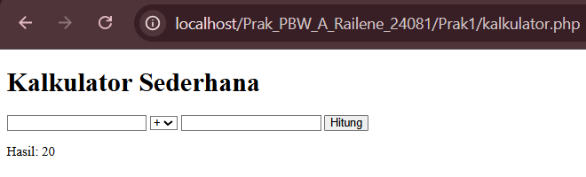

**biodata.php**

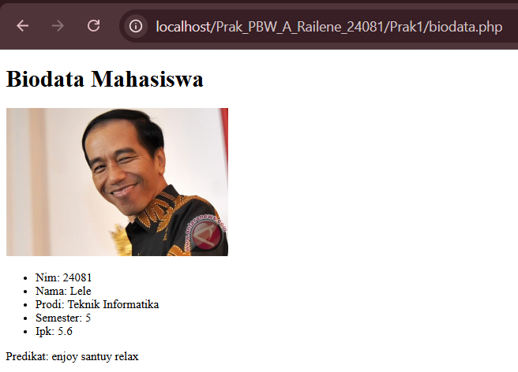

## 2. Modifikasi Program Minimal 2

### Modifikasi 1: Hitung Sekali Menjadi Hitung Bertahap

Kalkulator diubah dari hitung sekali menjadi hitung bertahap, menggunakan 3 hidden input (`num1`, `op`, `new_input`). Fungsinya untuk menyimpan memori pada kalkulator.

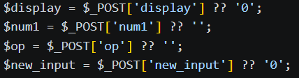

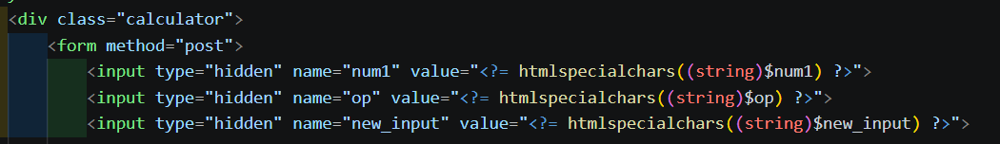

### Modifikasi 2: Operasi Hitung Baru

Menambahkan operasi hitung baru: akar kuadrat (`sqrt`), kuadrat (`sq`), dan modulo (`%`).

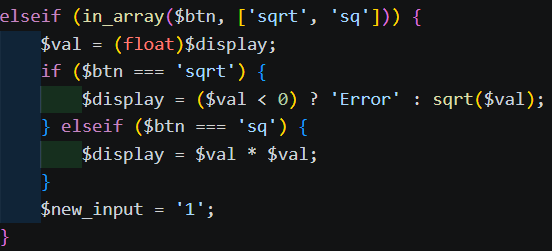

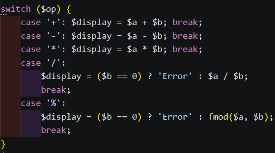

## 3. Penjelasan Bagian Kode yang Paling Penting

Penjelasan singkat lima bagian kode yang paling penting:

### 1. Tiga variabel `num1`, `op`, `new_input` lewat hidden input

Tiga variabel ini ditaruh sebagai hidden input di dalam form, supaya nilai dari kalkulator ikut terkirim ulang saat tombol dipencet. Hal ini diperlukan karena PHP bersifat *stateless*, yaitu server tidak bisa mengingat apa pun dari request sebelumnya.


### 2. Kondisi awal input angka

Kondisi ini menentukan kapan angka baru menimpa layar (kalau layar masih `0`, `Error`, atau habis menekan operator) dan kapan disambung ke angka yang sudah ada. Ada juga pengecekan supaya titik desimal tidak bisa diketik dua kali.

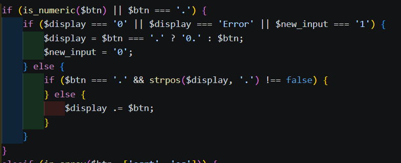

### 3. Akar kuadrat dan kuadrat

Pada akar kuadrat, angka dicek dulu apakah negatif. Angka negatif tidak punya hasil di bilangan real, jadi langsung menghasilkan `Error`. Kuadrat tidak perlu validasi karena hasilnya selalu ada dan tidak mungkin negatif.


### 4. Fungsi `statusKelulusan()`

Parameter dan return value diberi tipe data (`float` masuk, `string` keluar), supaya pengecekan sesuai dengan syarat. Kalau syarat terpenuhi, fungsi langsung `return` dan berhenti.

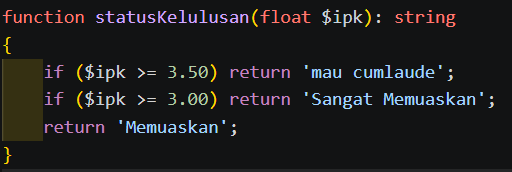

### 5. Penggunaan `htmlspecialchars()`

Semua data ditampilkan lewat `htmlspecialchars()` supaya karakter HTML tidak dibaca sebagai kode. Hal ini mencegah serangan XSS.

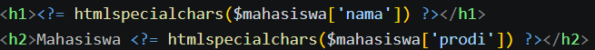

## 4. Tampilan Sebelum dan Sesudah Modifikasi

Berikut perbandingan tampilan program sebelum dan sesudah dilakukan modifikasi.

### 4.1 Tampilan Kalkulator

**a. Sebelum Modifikasi (`kalkulator.php`)**

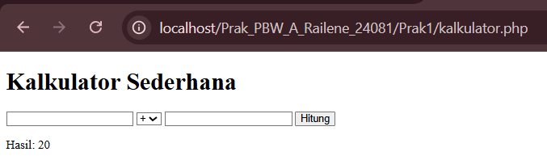

**b. Sesudah Modifikasi (`Kalkulator_Tugas1.php`)**

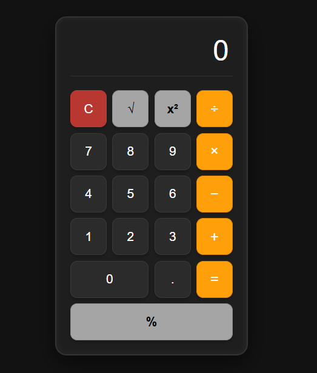

### 4.2 Tampilan Biodata

**a. Sebelum Modifikasi (`biodata.php`)**


**b. Sesudah Modifikasi (`biodata_tugas1.php`)**

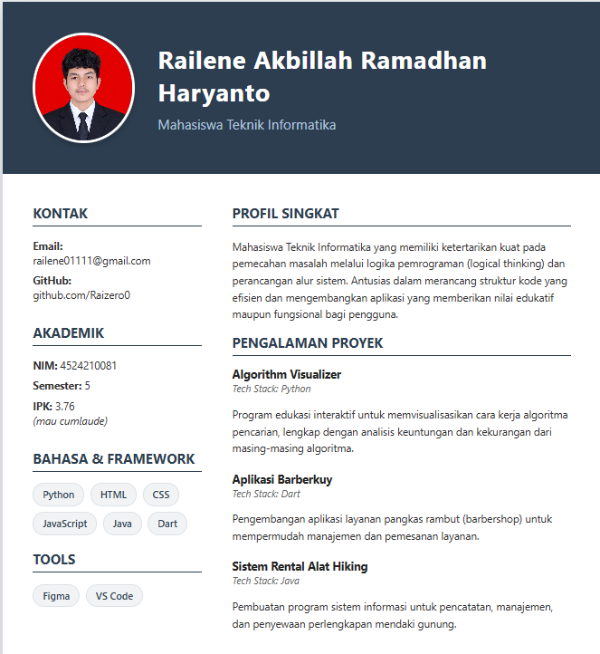

## 5. Error yang Pernah Muncul

Error muncul saat menambahkan tombol `%` (modulo) pada keypad kalkulator. Logika untuk operator ini sebenarnya sudah ada sejak awal di dalam kode, tetapi belum bisa digunakan karena belum ada tombolnya. Saat tombol ditambahkan dan dicoba menghitung angka desimal, misalnya `10.5 % 3`, browser menampilkan peringatan:

```
Deprecated: Implicit conversion from float 10.5 to int loses precision in
C:\laragon\www\Prak_PBW_A_Railene_24081\Prak1\Kalkulator_Tugas1.php on line 48
```


### Penyebab

Operator `%` di PHP dirancang khusus untuk bilangan bulat (*integer*), bukan bilangan desimal (*float*). Saat memasukkan angka desimal seperti `10.5`, PHP otomatis memotongnya menjadi `10` sebelum dihitung modulusnya. Akibatnya hasil di layar adalah `1`, padahal seharusnya `1.5`.

Baris kode sumber masalah, pada `Kalkulator_Tugas1.php` baris 48:

```php
case '%':
    $display = ($b == 0) ? 'Error' : $a % $b;
    break;
```

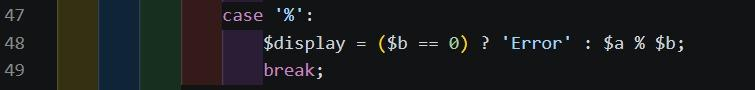

### Perbaikan

Operator `%` diganti dengan fungsi bawaan PHP `fmod()`, yang memang dibuat khusus untuk menghitung modulus pada bilangan desimal tanpa memotong presisinya:

```php
case '%':
    $display = ($b == 0) ? 'Error' : fmod($a, $b);
    break;
```

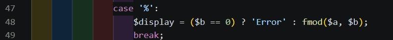

### Hasil Sebelum dan Sesudah Diperbaiki

**Sebelum** (hasil `1` dan muncul peringatan):

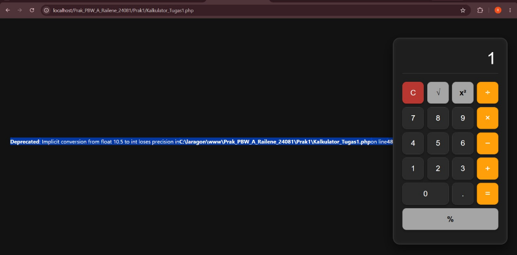

**Sesudah** (hasil `1.5`):

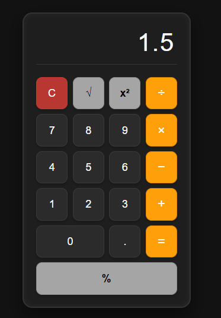

---

# Pertemuan 3

Materi: Instalasi, Konfigurasi, dan Halaman Pertama Laravel 12 (Arsitektur MVC, HTTP Request Lifecycle, Routing `routes/web.php`, dan Templating Blade `resources/views/`).

Proyek Utama: **LaraPress** (Aplikasi Blog Sederhana)

---

## 1. Cara Install Laravel

Susunan instalasi dan konfigurasi proyek disesuaikan dengan Modul Praktikum PBW Pertemuan 3:

### Kebutuhan Sistem & Environment

| Perangkat / Software | Standar Versi | Fungsi Utama |
| --- | --- | --- |
| **PHP** | Minimal Versi 8.2 | Programming Language Runtime |
| **Web Server & DB** | Laragon / XAMPP | Environment Web Server (Apache) & MySQL |
| **Dependency Manager** | Composer 2.x | Pustaka Manajer Dependensi PHP |
| **Terminal / CLI** | Terminal Laragon / CMD / Git Bash | Eksekutor perintah CLI Artisan & Composer |
| **Code Editor** | Visual Studio Code | Penyuntingan & pengelolaan kode sumber |
| **Web Browser** | Google Chrome / Firefox / Brave | Pengujian tampilan aplikasi web |

### Langkah-Langkah Instalasi Proyek LaraPress

1. **Membuat Proyek Baru via Composer**  
   Buka terminal pada root server web (`C:\laragon\www\` atau `C:\xampp\htdocs\`), lalu jalankan perintah:
   ```bash
   composer create-project laravel/laravel:"^12.0" LaraPress
   ```

2. **Masuk ke Direktori Proyek**  
   Pindahkan direktori aktif terminal ke folder proyek:
   ```bash
   cd LaraPress
   ```

3. **Konfigurasi Environment & Generate Application Key**  
   Salin file konfigurasi environment `.env` dan buat kunci enkripsi aplikasi:
   ```bash
   copy .env.example .env
   php artisan key:generate
   ```

4. **Menjalankan Development Server Lokal**  
   Jalankan server lokal bawaan Artisan:
   ```bash
   php artisan serve
   ```
   Aplikasi akan berjalan di alamat: `http://127.0.0.1:8000`

---

## 2. Tugas yang Dikerjakan

Berdasarkan Modul Praktikum Pertemuan 3, tugas yang diselesaikan meliputi dua bagian:

1. **Tugas Utama**:
   - Membangun proyek baru berbasis Laravel 12 bernama **LaraPress**.
   - Mendefinisikan rute utama `/` pada `routes/web.php` yang mengembalikan tampilan View Halaman Utama (`welcome.blade.php`).
   - Mendefinisikan rute `/tentang-kami` pada `routes/web.php` yang mengembalikan tampilan View Halaman Tentang Kami (`about.blade.php`).
   - Menghubungkan kedua halaman statis tersebut menggunakan link navigasi bolak-balik (`<a href="...">`).

2. **Tugas Mandiri (Wajib)**:
   - Membuat satu halaman statis baru bernama **Kontak**.
   - Mendefinisikan endpoint rute `/kontak` pada `routes/web.php` yang memanggil View `contact.blade.php`.
   - Mengisi halaman kontak dengan informasi kontak pengembang yang relevan dan menambahkan tautan navigasi ke halaman lainnya.

---

## 3. Fitur-Fitur Utama

Berikut adalah fitur-fitur yang ada pada aplikasi web LaraPress di Pertemuan 3:

* **Halaman Utama / Landing Page (`/`)**: Menampilkan banner ucapan selamat datang, deskripsi singkat platform LaraPress, 3 kartu highlight modul (MVC, Breeze, Blade), serta tombol direct link menuju repositori GitHub proyek.
* **Halaman Tentang Kami (`/tentang-kami`)**: Menampilkan informasi tujuan pengembangan proyek, teknologi yang digunakan (*tech stack*), environment server, serta kartu profil pengembang (Nama, NPM, Prodi, dan Kampus).
* **Halaman Hubungi Kami (`/kontak`)**: Menampilkan kartu informasi email *support*, lokasi kampus, serta tombol aksi interaktif *Direct Chat WhatsApp* yang langsung terhubung ke nomor WhatsApp pengembang (`+62 896-5630-2791`).
* **Navigasi Bar & Footer Konsisten**: Menyediakan menu navigasi yang konsisten di setiap halaman serta deteksi tombol status login/register.
* **Antarmuka Modern & Responsif**: Menggunakan Tailwind CSS dengan gaya *dark mode*, warna aksen neon cyan & indigo, serta efek tampilan *glassmorphism*.

---

## 4. Hasil Foto Tugas 3

Berikut adalah hasil tangkapan layar antarmuka proyek LaraPress pada Pertemuan 3:

### 4.1 Halaman Utama (`/`)

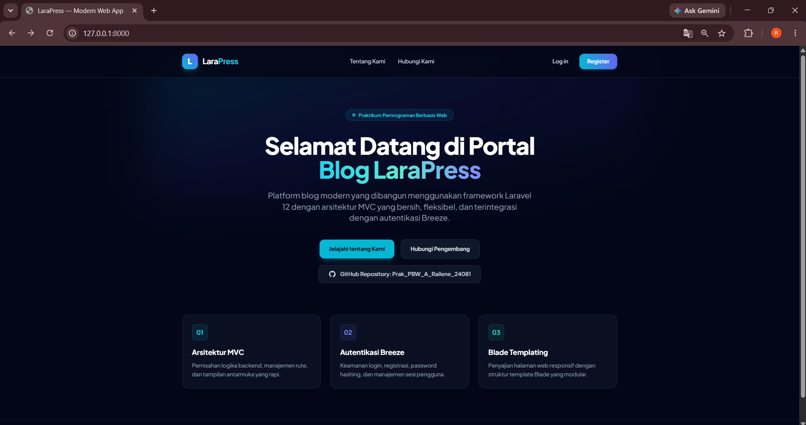

### 4.2 Halaman Tentang Kami (`/tentang-kami`)

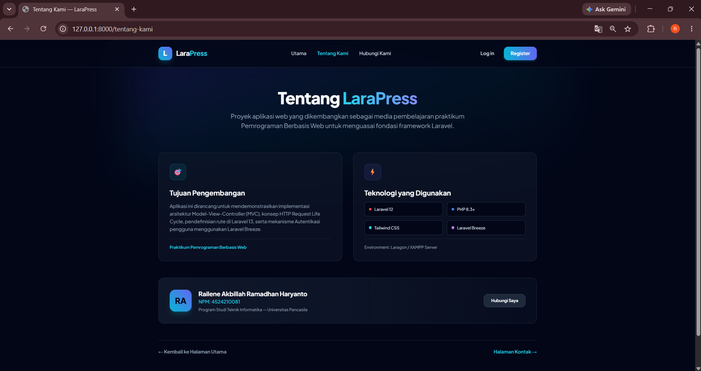

### 4.3 Halaman Hubungi Kami (`/kontak`)

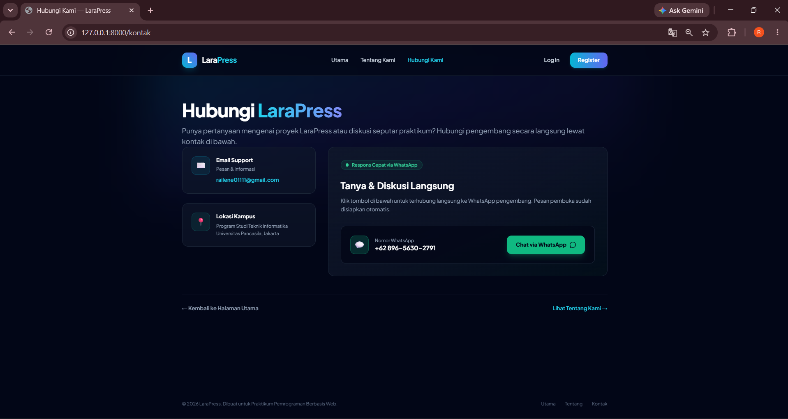

---

# Pertemuan 4

Materi : Authentikasi Login

Proyek Utama: **LaraPress**

---

## 1. Cara Install

Susunan instalasi dan konfigurasi sistem autentikasi disesuaikan dengan Modul Praktikum PBW Pertemuan 4:

### Kebutuhan Sistem & Environment

| Perangkat / Package | Standar Versi | Fungsi Utama |
| --- | --- | --- |
| **PHP** | Minimal Versi 8.2 | Programming Language Runtime |
| **Framework** | Laravel 12.x | Framework Utama Aplikasi Web |
| **Starter Kit** | Laravel Breeze | Package Starter Kit Autentikasi |
| **Database Engine** | MySQL / MariaDB (Laragon / XAMPP) | Penyimpanan Tabel Users & Sessions |
| **Frontend Tooling** | Node.js & NPM (Tailwind CSS) | Asset Bundler & Styling Frontend |

### Langkah-Langkah Instalasi Laravel Breeze

1. **Masuk ke Direktori Proyek LaraPress**  
   Buka terminal, lalu arahkan aktif terminal ke folder proyek `LaraPress`:
   ```bash
   cd LaraPress
   ```

2. **Instalasi Package Laravel Breeze via Composer**  
   Unduh pustaka dependensi Breeze ke dalam proyek:
   ```bash
   composer require laravel/breeze --dev
   ```

3. **Eksekusi Command Artisan Breeze Install**  
   Publikasikan komponen Controllers, Views, dan Routes bawaan Breeze:
   ```bash
   php artisan breeze:install
   ```
   *Pilihan Konfigurasi CLI:*
   - Stack pilihan: `Blade with Alpine` (Pilih 0)
   - Dark mode support: `No`
   - Testing framework: `Pest` (Pilih 0)

4. **Instalasi Dependensi Frontend & Compiling Assets**  
   Instal pustaka JavaScript/Tailwind dan lakukan kompilasi aset:
   ```bash
   npm install
   npm run dev
   ```

5. **Jalankan Migrasi Database**  
   Eksekusi migrasi untuk membuat tabel `users`, `password_reset_tokens`, dan `sessions`:
   ```bash
   php artisan migrate
   ```

6. **Menjalankan Development Server Lokal**  
   Jalankan server Artisan bawaan Laravel:
   ```bash
   php artisan serve
   ```
   Aplikasi dan rute autentikasi akan aktif di alamat: `http://127.0.0.1:8000`

---

## 2. Tugas yang Dikerjakan

Berdasarkan Modul Praktikum Pertemuan 4, tugas yang diselesaikan meliputi empat bagian utama:

1. **Memahami Konsep & Filosofi Autentikasi**:
   - Memahami perbedaan Autentikasi ("Siapa Anda?") dan Otorisasi ("Apa yang boleh dilakukan?").
   - Memahami mekanisme Password Hashing (Bcrypt) satu arah dan proteksi CSRF (`@csrf`).
   - Memahami peran Cookies dan Sessions sebagai penanda status login pengguna pada protokol HTTP yang *stateless*.

2. **Instalasi & Konfigurasi Laravel Breeze**:
   - Mengintegrasikan package Laravel Breeze ke dalam aplikasi blog **LaraPress**.
   - Menjalankan migrasi struktur database pendukung autentikasi.

3. **Mengamankan Rute Terproteksi dengan Middleware `auth`**:
   - Mendaftarkan rute terproteksi untuk `/dashboard` dan grup rute `/profile` di file `routes/web.php`.
   - Menguji pengalihan otomatis (*redirect*) pengguna yang belum terautentikasi kembali ke halaman `/login`.

4. **Kustomisasi UI & Antarmuka Modern**:
   - Merombak tampilan bawaan Breeze (`login.blade.php`, `register.blade.php`, `dashboard.blade.php`, dan `edit.blade.php` profil) agar serasi dengan antarmuka LaraPress berbasis Tailwind CSS *dark mode*, aksen neon cyan & indigo, serta efek *glassmorphism*.

---

## 3. Fitur-Fitur Utama

Berikut adalah fitur-fitur utama sistem autentikasi pada aplikasi LaraPress di Pertemuan 4:

* 🔑 **Autentikasi Registrasi & Login**: Menyediakan form registrasi akun baru dan form login dengan validasi kredensial email & password.
* 🛡️ **Keamanan Password Hashing & CSRF**: Password terenkripsi secara otomatis menggunakan algoritma hashing Bcrypt, serta seluruh form terlindungi token `@csrf`.
* 🚧 **Proteksi Rute Middleware (`auth`)**: Mengunci rute khusus seperti `/dashboard` dan `/profile` agar tidak bisa diakses langsung tanpa sesi login yang valid.
* 👤 **Dashboard Admin Interaktif**: Menampilkan panel pusat kendali administrator terproteksi yang menampilkan ucapan selamat datang dinamis (`Auth::user()->name`) dan status akun terdaftar.
* ⚙️ **Pengelolaan Profil & Keamanan Akun**: Menyediakan halaman khusus bagi pengguna terautentikasi untuk mengedit informasi nama, email, mengubah kata sandi, serta menghapus akun.
* 🎨 **Antarmuka Modern Dark Mode**: Tampilan terintegrasi penuh menggunakan Tailwind CSS dengan efek *glassmorphism*, font Plus Jakarta Sans, dan warna aksen neon cyan & indigo.

---

## 4. Hasil Foto Tugas 4

Berikut adalah hasil tangkapan layar antarmuka sistem autentikasi LaraPress pada Pertemuan 4:

### 4.1 Halaman Login (`/login`)

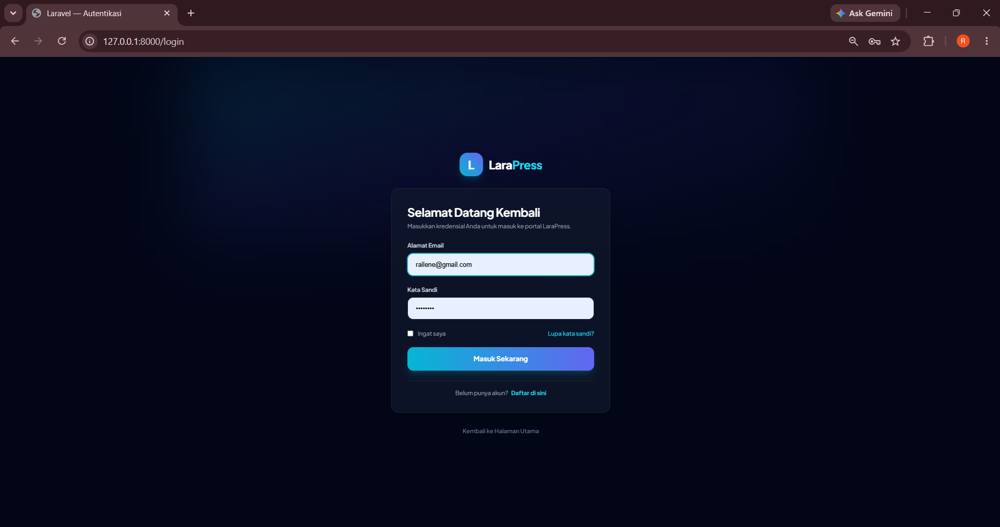

### 4.2 Halaman Registrasi (`/register`)

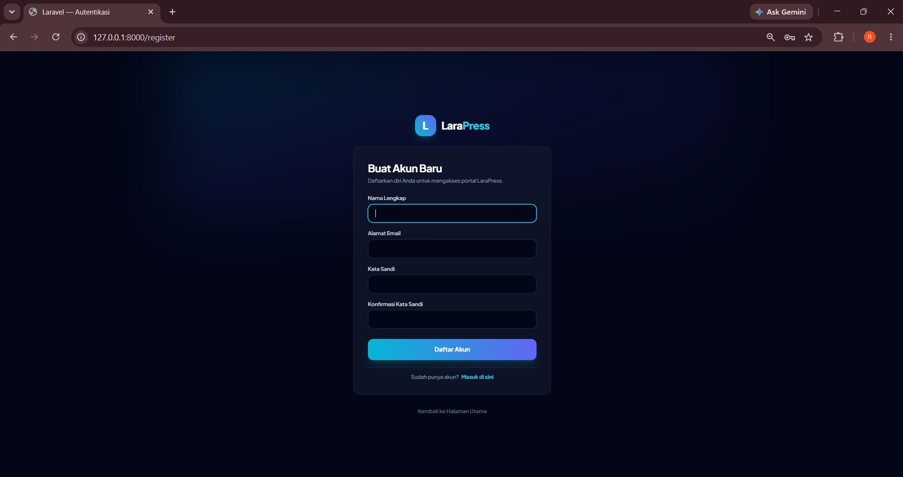

### 4.3 Halaman Dashboard Admin (`/dashboard`)

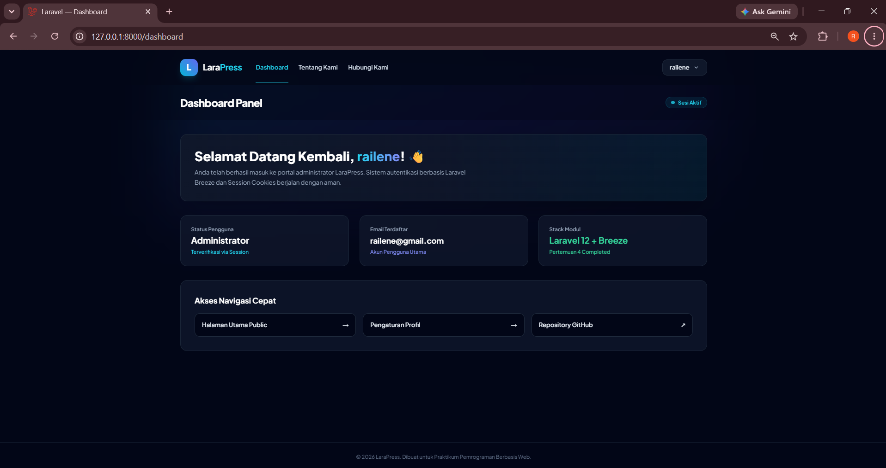

### 4.4 Halaman Pengaturan Profil (`/profile`)

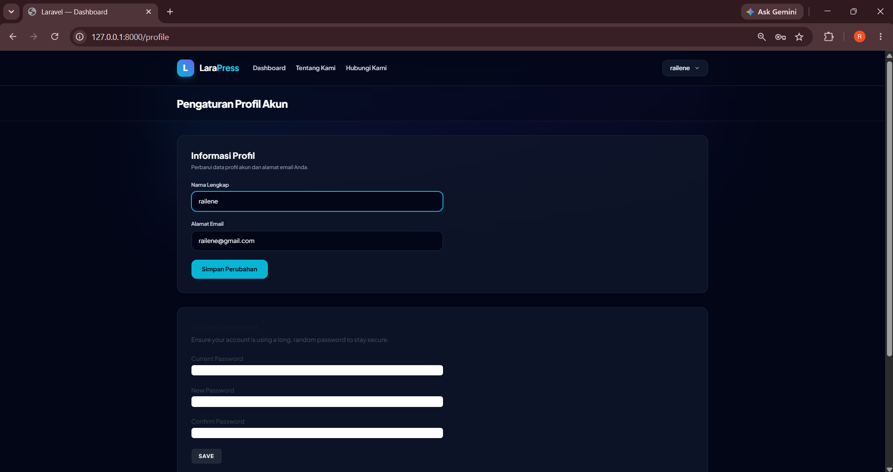

---

# Pertemuan 5

Materi: Implementasi Operasi **CRUD (Create, Read, Update, Delete)** Penuh pada Framework Laravel 12, Konfigurasi Dinamis Menggunakan Caching (*Dynamic Settings*), Sistem Buku Tamu Digital, Pengamanan Rute Terproteksi dengan Middleware Autentikasi Laravel Breeze, serta Kustomisasi Antarmuka Web Sekolah Modern (*Light Minimalist Modern UI*).

Proyek Utama: **SMP Mentari** (Portal Web Sekolah & Panel Admin Kontrol)

## 1. Cara Install

Susunan instalasi dan konfigurasi proyek disesuaikan dengan Modul Praktikum PBW Pertemuan 5:

### Kebutuhan Sistem & Environment

| Perangkat / Package | Standar Versi | Fungsi Utama | 
| ----- | ----- | ----- | 
| **PHP** | Minimal Versi 8.2 | Programming Language Runtime | 
| **Framework** | Laravel 12.x | Framework Utama Aplikasi Web | 
| **Starter Kit** | Laravel Breeze | Sistem Autentikasi Pengurus/Admin | 
| **Database Engine** | MySQL / MariaDB (Laragon / XAMPP) | Penyimpanan Tabel Users, Kegiatan, Pesan Tamu, & Settings | 
| **Frontend Tooling** | Node.js & NPM (Tailwind CSS) | Asset Bundler & Styling UI Responsive | 

### Langkah-Langkah Instalasi Proyek SMP Mentari

1. **Membuat Proyek Baru via Composer**

   Buka terminal di root web server (`C:\laragon\www\`), lalu jalankan perintah:

   ```bash
   composer create-project laravel/laravel SMP-Mentari
   cd SMP-Mentari
   ```

2. **Instalasi & Konfigurasi Starter Kit Laravel Breeze**

   Unduh dan jalankan instalasi Breeze Blade untuk sistem autentikasi:

   ```bash
   composer require laravel/breeze --dev
   php artisan breeze:install blade
   ```

3. **Instalasi Dependensi Frontend & Compiling Assets**

   Instal pustaka JavaScript dan Tailwind CSS:

   ```bash
   npm install
   npm run dev
   ```

4. **Menjalankan Migrasi Database & Seeding Konfigurasi**

   Jalankan perintah migrasi untuk membuat tabel `users`, `kegiatans`, `pesan_tamus`, dan `settings`:

   ```bash
   php artisan migrate
   ```

5. **Menjalankan Development Server Lokal**

   Jalankan server Artisan lokal untuk mengakses portal web:

   ```bash
   php artisan serve
   ```

   Aplikasi web aktif di alamat: `http://127.0.0.1:8000`

---

## 2. Tugas yang Dikerjakan

Berdasarkan Modul Praktikum Pertemuan 5, tugas yang diselesaikan meliputi lima bagian utama:

1. **Skema Database & Migrasi (*Migrations*)**:
   * Membuat file migrasi tabel `pesan_tamus` (kolom `nama`, `email`, `pesan`).
   * Membuat file migrasi tabel `kegiatans` (kolom `judul`, `deskripsi`).
   * Membuat file migrasi tabel `settings` (kolom `key`, `value`, `type`, `description`) beserta data awal (*seeding*) untuk konfigurasi `home_kegiatan_per_page`.

2. **Pengembangan Eloquent Model & Caching**:
   * Menyiapkan model `PesanTamu` dan `Kegiatan` dengan properti `$fillable`.
   * Menyiapkan model `Setting` yang dilengkapi *static methods* (`get`, `set`, dan `clearCache`) menggunakan `Cache::remember` untuk mengoptimalkan performa pembacaan konfigurasi dinamis.

3. **Pembangunan Controller & Logika Bisnis**:
   * **`PageController`**: Menampilkan halaman utama publik (`/`) dengan jumlah kegiatan dinamis berdasarkan setting per halaman.
   * **`KegiatanController`**: Mengelola seluruh operasi CRUD data kegiatan sekolah (`index`, `create`, `store`, `edit`, `update`, `destroy`).
   * **`PesanTamuController`**: Mengelola pengiriman pesan publik (`/bukutamu`) dan pengelolaan/penghapusan pesan oleh admin (`/admin/bukutamu`).
   * **`DashboardController`**: Menyediakan ringkasan metrik statistik kegiatan, pesan masuk, dan sampel pesan terbaru.
   * **`SettingController`**: Mengelola pembaruan nilai konfigurasi dinamis website.

4. **Routing Terstruktur (`routes/web.php`)**:
   * Mendefinisikan rute publik (`/` dan `/bukutamu`).
   * Mendefinisikan grup rute terproteksi middleware `auth` untuk area admin (`/dashboard`, `/kegiatan`, `/admin/bukutamu`, `/settings`, dan `/profile`).

5. **Kustomisasi Antarmuka Modern (*Light Minimalist Modern UI*)**:
   * Merombak total antarmuka web menjadi bersih, kontras, dan terstruktur berbasis Tailwind CSS dengan warna utama *Royal Blue*, *Pure White Card*, dan *Slate Palette*.

---

## 3. Fitur-Fitur Utama

Sistem web SMP Mentari pada Pertemuan 5 menyediakan fitur-fitur berikut:

### A. Fitur Halaman Publik
* 🏠 **Portal Berita & Kegiatan Sekolah (`/`)**: Menampilkan *Hero Banner* interaktif, statistik ringkas sekolah, daftar kegiatan sekolah terbaru dengan sistem *pagination*, serta indikator akreditasi.
* 💬 **Buku Tamu Digital Pengunjung (`/bukutamu`)**: Formulir publik bagi pengunjung untuk mengirimkan pesan/kesan dan menampilkan daftar masukan dari masyarakat secara langsung.

### B. Fitur Panel Admin Terproteksi
* 📊 **Dashboard Administrator (`/dashboard`)**: Pusat kontrol yang menampilkan ucapan selamat datang dinamis, kartu metrik jumlah kegiatan & pesan masuk, serta *preview* pesan terbaru.
* 📌 **Kelola CRUD Kegiatan (`/kegiatan`)**: Fitur lengkap untuk membuat, melihat, memperbarui, dan menghapus data agenda/berita kegiatan sekolah.
* ✉️ **Moderasi Buku Tamu (`/admin/bukutamu`)**: Tabel manajemen bagi administrator untuk meninjau dan menghapus pesan pengunjung.
* ⚙️ **Konfigurasi Dinamis Website (`/settings`)**: Panel pengaturan angka pagination atau preferensi sistem yang tersimpan di database dan di-cache secara otomatis.
* 👤 **Pengelolaan Profil & Keamanan (`/profile`)**: Fitur kustomisasi profil pengurus, pembaruan kata sandi, dan penghapusan akun.

---

## 4. Hasil Foto Tugas

Berikut adalah tangkapan layar hasil pengujian antarmuka aplikasi SMP Mentari pada Pertemuan 5:

### 4.1 Halaman Utama Publik (`/`)
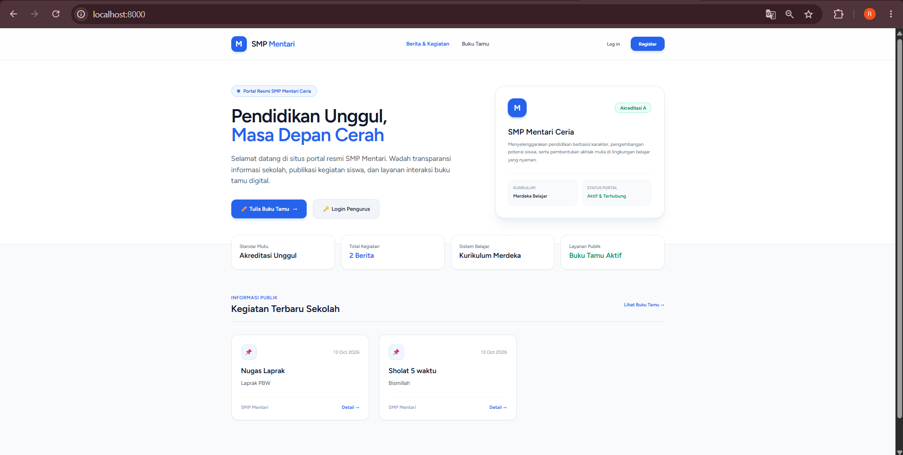

### 4.2 Halaman Buku Tamu Publik (`/bukutamu`)
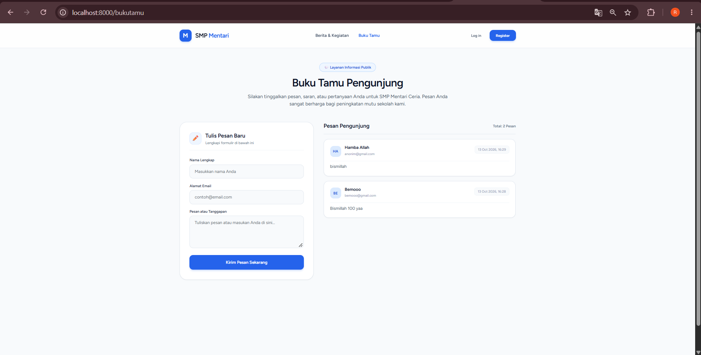

### 4.3 Dashboard Administrator (`/dashboard`)
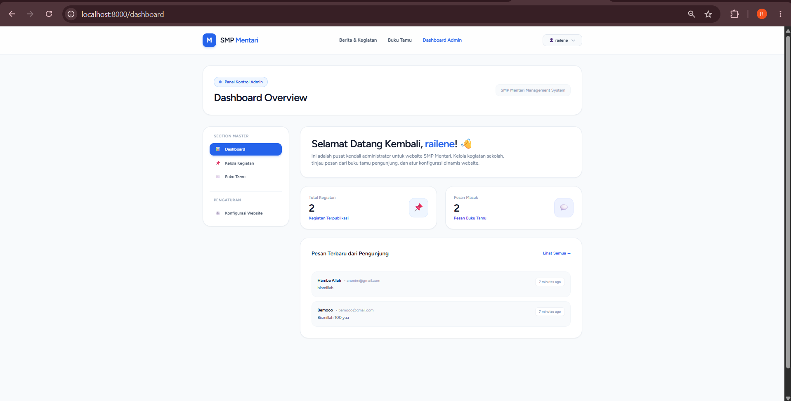

### 4.4 Kelola Daftar Kegiatan Admin (`/kegiatan`)
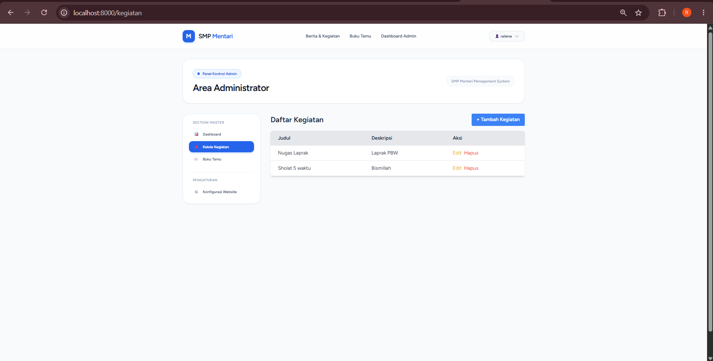

### 4.5 Form Tambah Kegiatan Baru (`/kegiatan/create`)
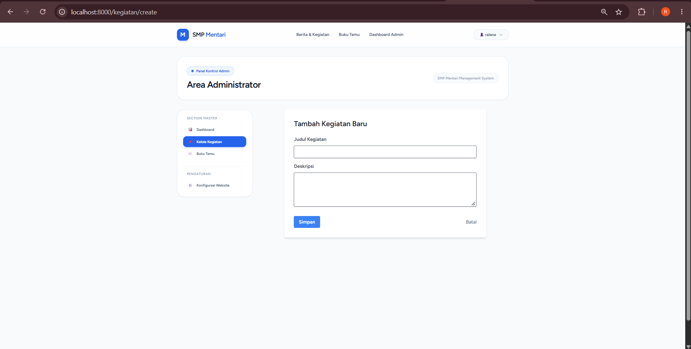

### 4.6 Form Edit / Ubah Kegiatan (`/kegiatan/{id}/edit`)
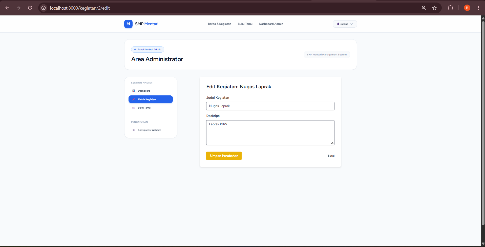

### 4.7 Kelola Buku Tamu Admin (`/admin/bukutamu`)
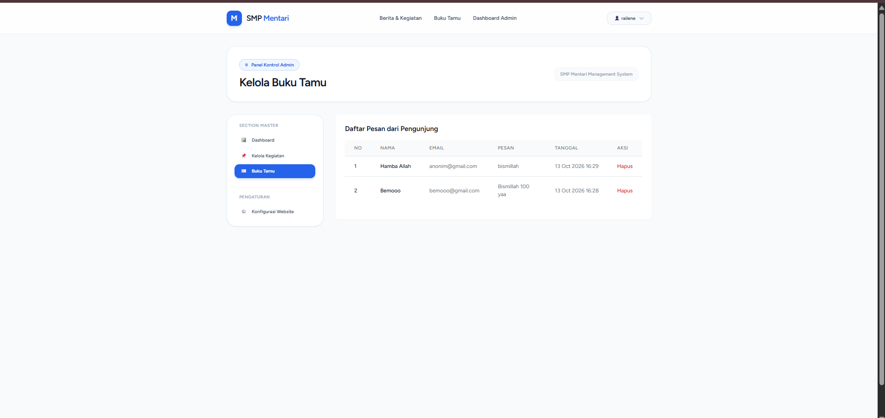

### 4.8 Konfigurasi Dinamis Website (`/settings`)
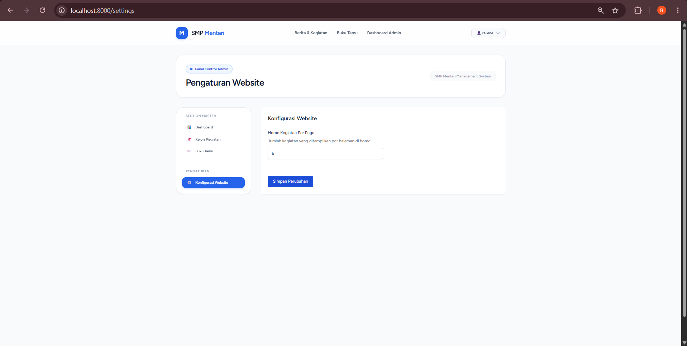

### 4.9 Halaman Login Pengurus (`/login`)
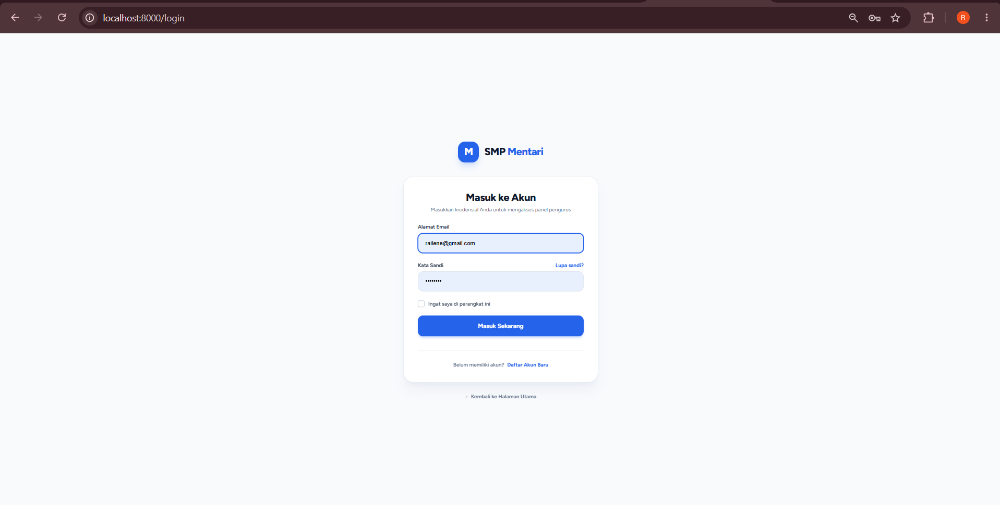

### 4.10 Halaman Registrasi Akun Baru (`/register`)
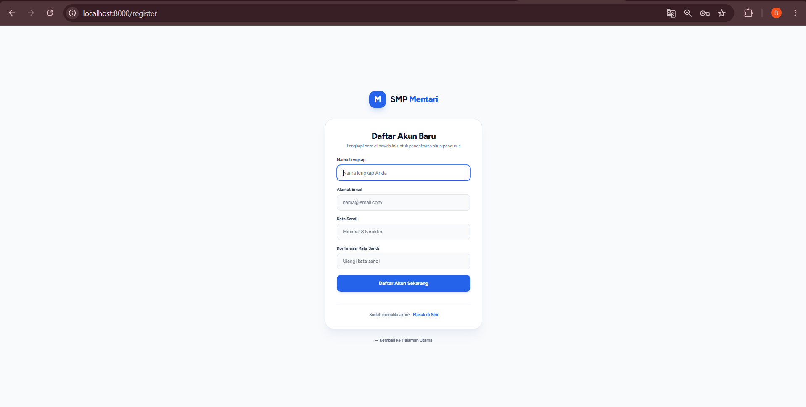

---

# Pertemuan 6

Materi: Membangun aplikasi manajemen buku dengan **Laravel** dan **Filament 3.x** (admin panel, CRUD lewat Resource, relasi database, upload file, Policy, dan widget dashboard).

Proyek Utama: **AuthBook** (Sistem Manajemen Buku), folder [`authbook`](authbook)

Versi yang dipakai: Laravel 13, PHP 8.3, Filament 3.3.57, MySQL (Laragon).

---

## 6.1 Cara Install dan Menjalankan

### Kebutuhan

| Kebutuhan | Keterangan |
| --- | --- |
| PHP | Versi 8.2 ke atas (dipakai 8.3) |
| Composer | Dependency manager PHP |
| Laragon | Menyediakan MySQL |
| Git | Untuk clone repositori |

### Langkah

1. **Ambil project**
   ```bash
   git clone https://github.com/Raizero0/Prak_PBW_A_Railene_24081.git
   cd Prak_PBW_A_Railene_24081/authbook
   ```

2. **Install dependency**
   ```bash
   composer install
   ```

3. **Siapkan environment**
   ```bash
   copy .env.example .env
   php artisan key:generate
   ```
   Lalu buka `.env` dan atur database. Buat dulu database kosong bernama `authbook` lewat phpMyAdmin Laragon.
   ```
   DB_CONNECTION=mysql
   DB_HOST=127.0.0.1
   DB_PORT=3306
   DB_DATABASE=authbook
   DB_USERNAME=root
   DB_PASSWORD=
   ```

4. **Buat tabel dan isi data contoh**
   ```bash
   php artisan migrate:fresh --seed
   php artisan storage:link
   ```

5. **Jalankan server**
   ```bash
   php artisan serve
   ```
   Admin panel: `http://localhost:8000/admin/login`

### Akun Login

Password semua akun: `password`

| Email | Role | Hak akses |
| --- | --- | --- |
| `admin@example.com` | admin | Semua akses |
| `staff@example.com` | staff | Lihat, tambah, ubah (tidak bisa hapus) |
| `viewer@example.com` | viewer | Hanya lihat |

---

## 6.2 Tugas 1: Implementasi Dasar

Pada tugas ini dibuat aplikasi manajemen buku dengan data penulis (`Author`) dan buku (`Book`).

Yang dikerjakan:

- Setup project Laravel dan install Filament (`php artisan filament:install --panels`).
- Membuat migration dan model `Author` dan `Book` (relasi satu penulis punya banyak buku).
- Membuat factory dan seeder: 10 penulis dan 50 buku data contoh.
- Membuat `AuthorResource` dan `BookResource` untuk CRUD, lengkap dengan pencarian, filter, upload cover, dan bulk delete.

### Hasil Foto Tugas 1

**1. Admin panel setelah berhasil login**

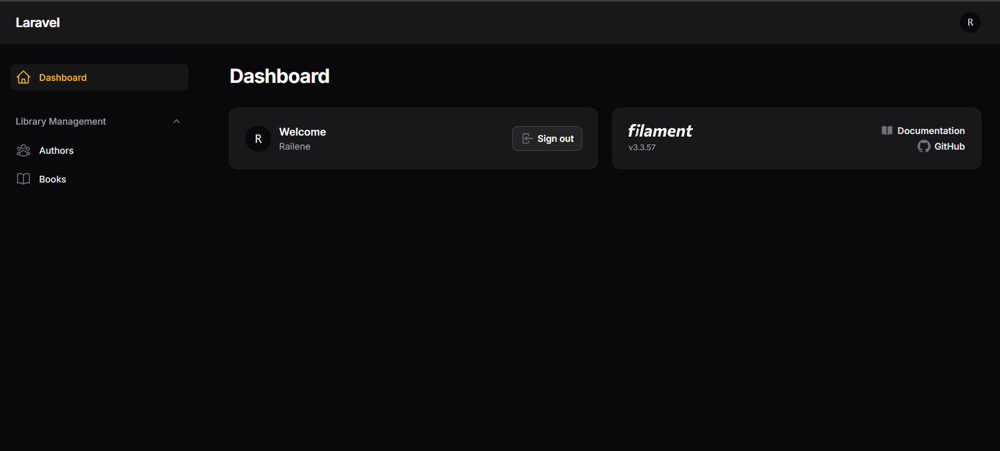

**2. List books dengan data seed (50 buku)**

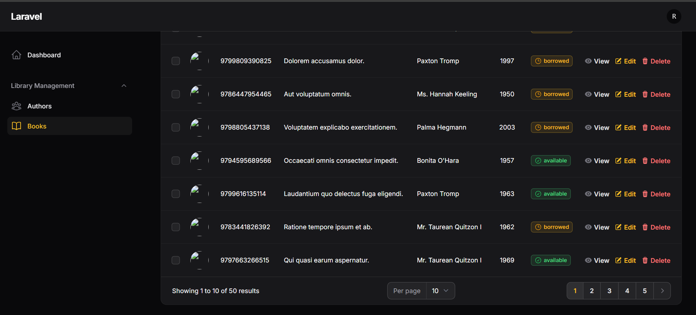

**3. Form create book**

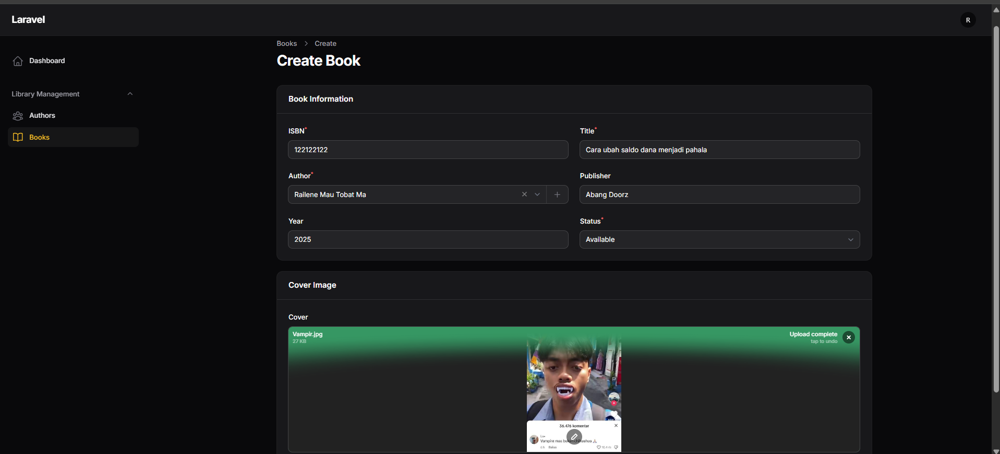

**4. Hasil pencarian**

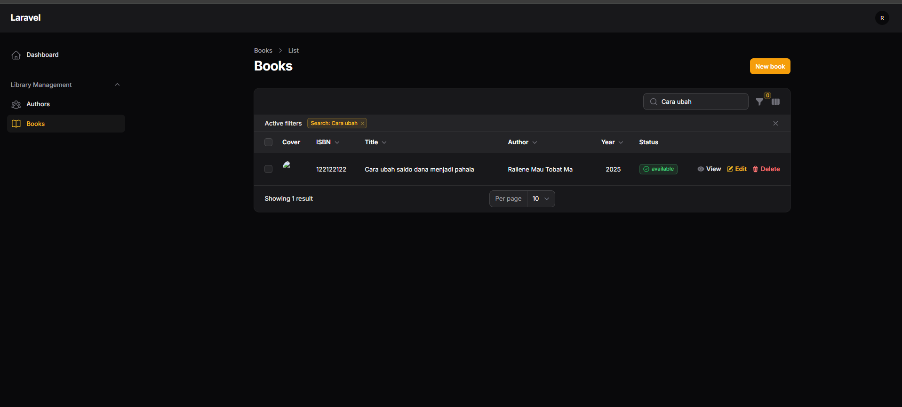

**5. Filter aktif (Status dan Year)**

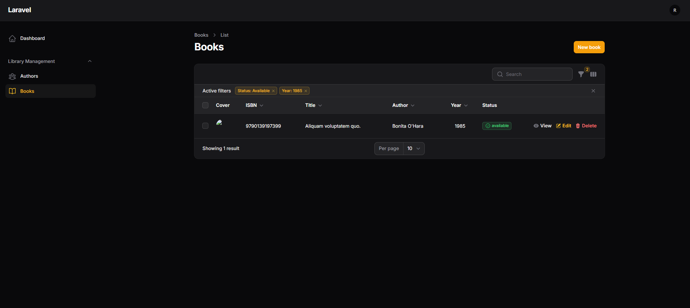

---

## 6.3 Tugas 2: Kustomisasi dan Pengembangan

### 6.3.1 Field Description pada Book

Menambah kolom `description` (text) pada tabel `books`.

| Bagian | Yang dilakukan |
| --- | --- |
| Migration | `add_description_to_books_table`, kolom `text('description')->nullable()` |
| Model | `description` ditambahkan ke `$fillable` pada `Book` |
| Resource | Komponen `Textarea::make('description')` di form, dan `TextEntry` di halaman View |
| Factory | `'description' => fake()->paragraph()` |

```php
// migration
$table->text('description')->nullable()->after('status');

// BookResource (form)
Forms\Components\Textarea::make('description')
    ->rows(5)
    ->columnSpanFull(),
```

**Foto**

Form create dengan field Description:

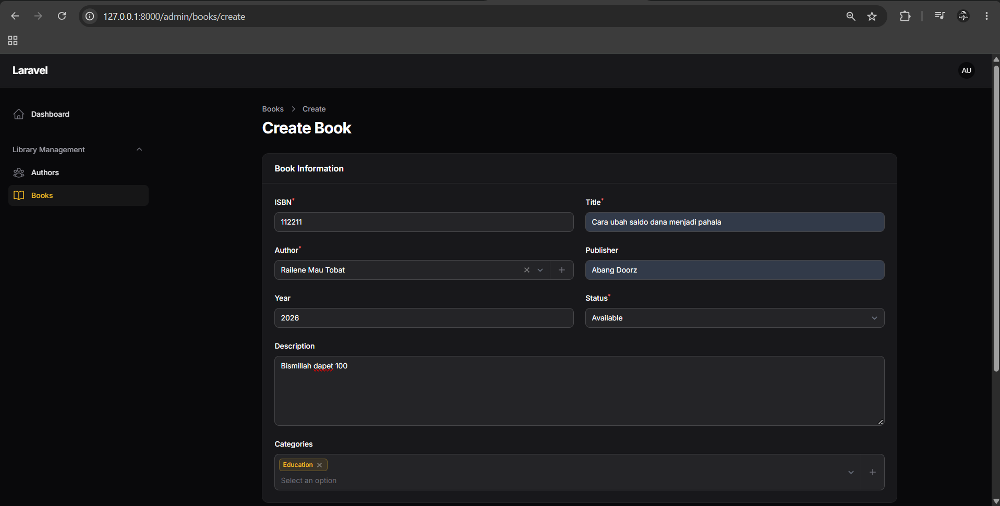

Halaman View menampilkan description:

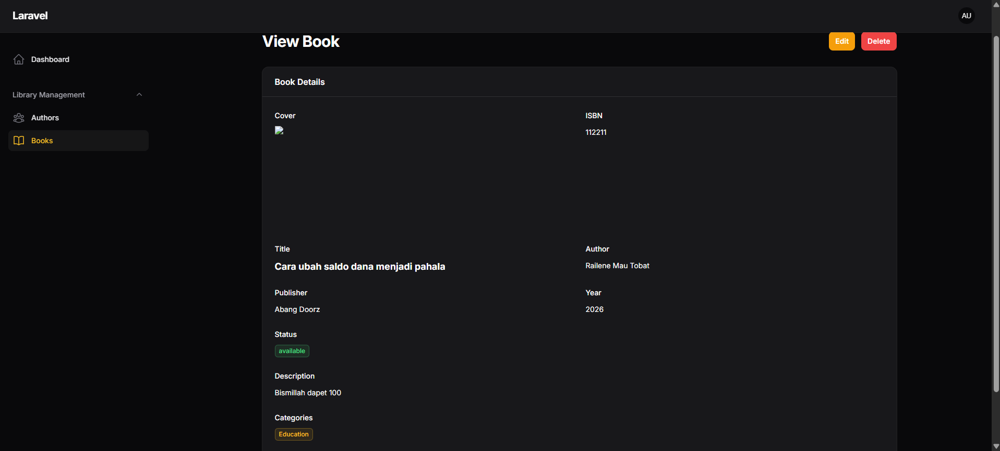

Form edit buku seed, description terisi dari factory:

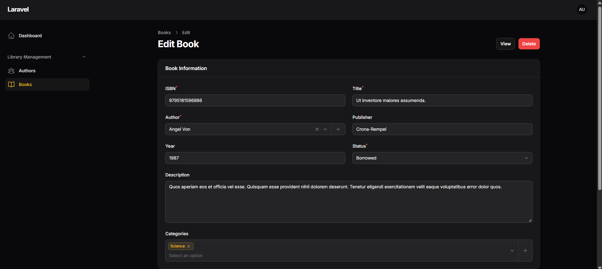

### 6.3.2 Role-Based Access

Pembatasan akses berdasarkan kolom `role` pada tabel `users`.

| Bagian | Yang dilakukan |
| --- | --- |
| Migration | `add_role_to_users_table`, kolom `enum('role', ['admin','staff','viewer'])`, default `viewer` |
| Model | `role` ditambahkan ke atribut `#[Fillable]` pada `User` |
| Seeder | `UserSeeder` membuat 3 akun: admin, staff, viewer |
| Policy | `BookPolicy` (sesuai tugas) dan `AuthorPolicy` (disamakan agar konsisten) |

Hak akses yang berlaku pada menu Books dan Authors:

| Aksi | Admin | Staff | Viewer |
| --- | :---: | :---: | :---: |
| Lihat (view) | ✅ | ✅ | ✅ |
| Tambah (create) | ✅ | ✅ | ❌ |
| Ubah (edit) | ✅ | ✅ | ❌ |
| Hapus (delete dan bulk delete) | ✅ | ❌ | ❌ |

```php
public function create(User $user): bool
{
    return in_array($user->role, ['admin', 'staff']);
}

public function delete(User $user, Book $book): bool
{
    return $user->role === 'admin';
}

// dipakai Filament untuk bulk delete
public function deleteAny(User $user): bool
{
    return $user->role === 'admin';
}
```

Method `deleteAny` sengaja ditambahkan. Tanpa itu, staff masih bisa melakukan bulk delete walaupun `delete()` sudah dibatasi.

**Foto**

Admin, menu Books (semua tombol tampil):

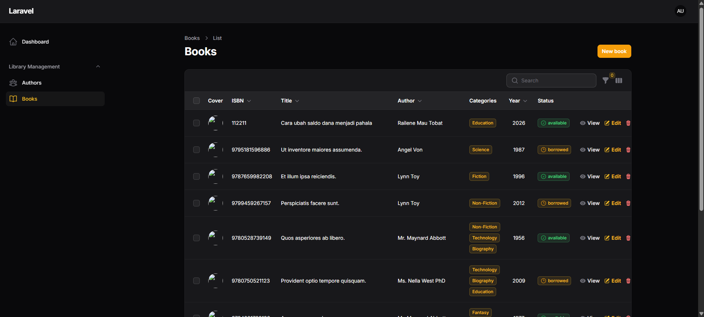

Admin, menu Authors:

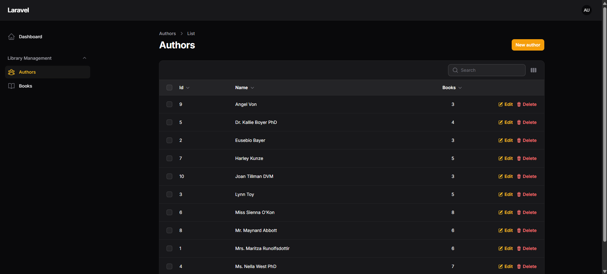

Staff, menu Books (tanpa Delete dan bulk delete):

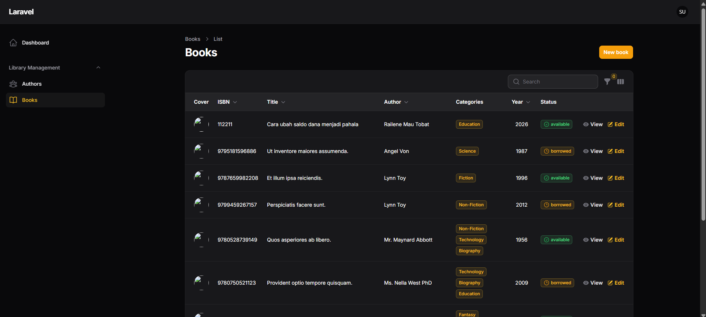

Staff, menu Authors (tanpa Delete):

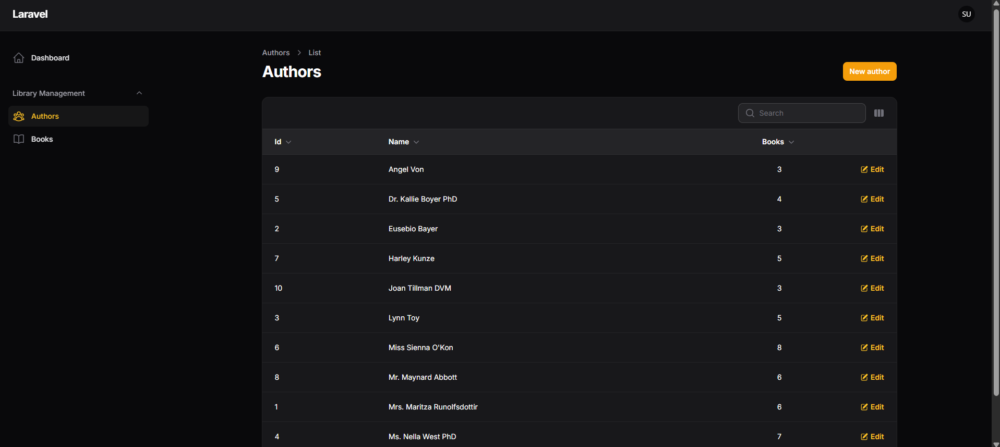

Viewer, menu Books (hanya View):

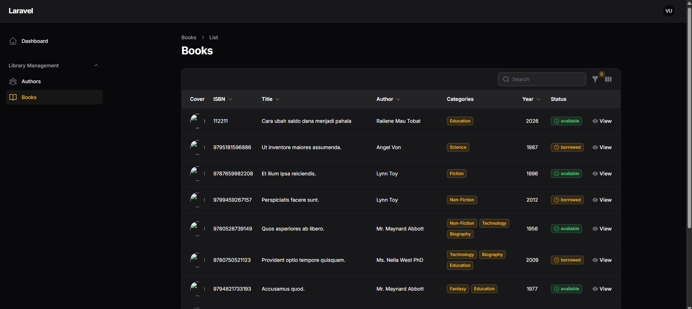

Viewer, menu Authors (tanpa aksi tambah, ubah, hapus):

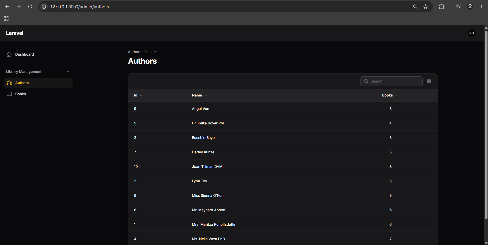

Viewer membuka `/admin/books/create` langsung lewat URL, ditolak 403:

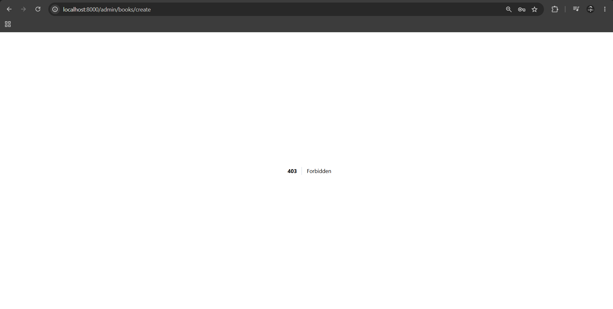

### 6.3.3 Widget Dashboard

Dua widget ditambahkan di folder `app/Filament/Widgets`.

| Widget | Isi |
| --- | --- |
| `BookStatsOverview` | 4 kartu: Total Books, Total Authors, Available, Borrowed |
| `BookStatusChart` | Chart donut perbandingan buku Available dan Borrowed |

```php
Stat::make('Total Books', Book::count()),
Stat::make('Available', Book::where('status', 'available')->count()),
```

Widget terbaca otomatis lewat `discoverWidgets()` di `AdminPanelProvider`.

**Foto**

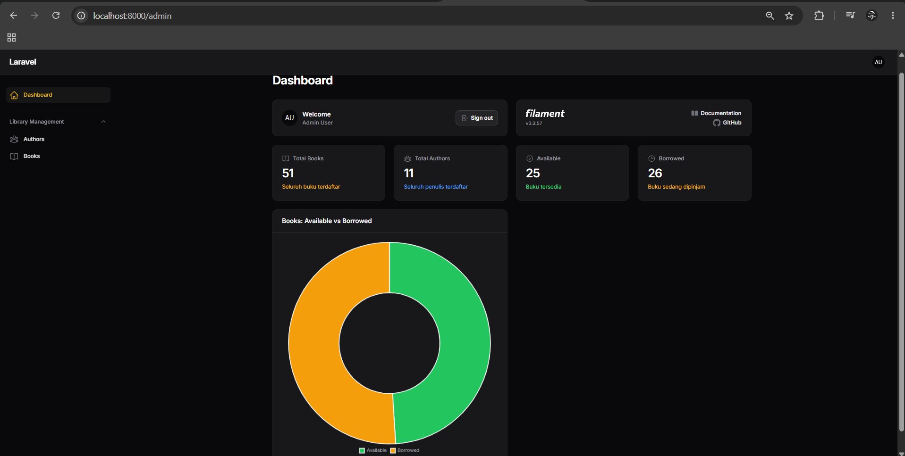

### 6.3.4 Kategori Buku

Relasi **many-to-many** antara Book dan Category lewat tabel pivot `book_category`.

| Bagian | Yang dilakukan |
| --- | --- |
| Model | `Category` dengan relasi `books()` |
| Migration | Tabel `categories` dan tabel pivot `book_category` (kedua foreign key `cascadeOnDelete`, pasangan unik) |
| Relasi | `Book::categories()` dan `Category::books()` memakai `belongsToMany` |
| Form | `Select::make('categories')->relationship('categories', 'name')->multiple()` |
| Seeder | `CategorySeeder` (8 kategori), tiap buku mendapat 1 sampai 3 kategori acak |

Sebagai tambahan di luar tugas, kategori juga tampil sebagai badge di tabel Books dan halaman View.

**Foto**

Form dengan multiple select kategori:

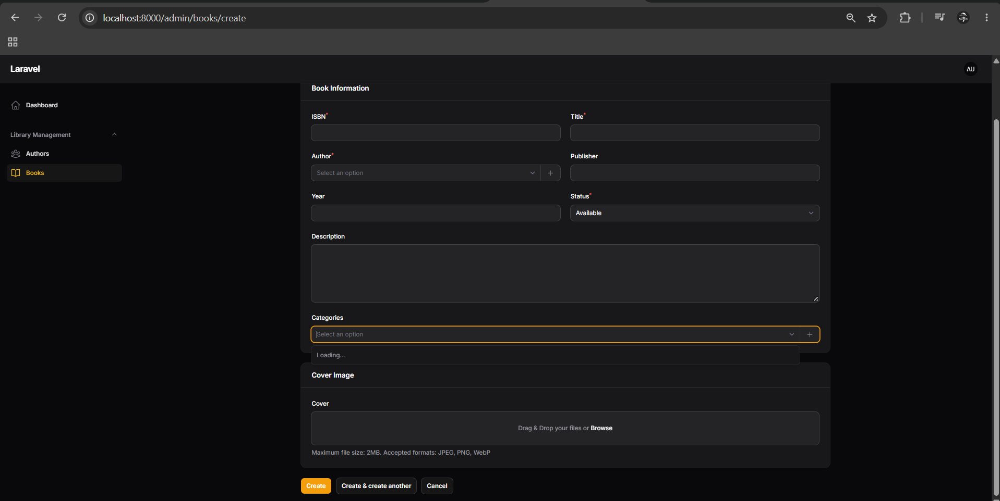

Kolom kategori sebagai badge di list Books:


Kategori di halaman View:


---

## 6.4 Tugas 3: Analisis dan Dokumentasi

### 6.4.1 Penjelasan Arsitektur

#### Diagram ERD

Diagram berikut menampilkan 5 tabel utama aplikasi. Tabel bawaan Laravel seperti `sessions`, `cache`, dan `jobs` tidak ditampilkan.


#### Penjelasan Relasi Antar Tabel

| Relasi | Jenis | Keterangan |
| --- | --- | --- |
| `authors` → `books` | One-to-Many | Satu penulis punya banyak buku. Foreign key `books.author_id`. Jika penulis dihapus, bukunya ikut terhapus (`onDelete('cascade')`). |
| `books` ↔ `categories` | Many-to-Many | Satu buku bisa punya banyak kategori, satu kategori bisa dipakai banyak buku. Dihubungkan tabel pivot `book_category`. Jika buku atau kategori dihapus, baris pivotnya ikut terhapus. |
| `users` | Berdiri sendiri | Tidak punya foreign key ke tabel lain. Kolom `role` dipakai oleh Policy untuk menentukan hak akses. |

Di sisi model Eloquent:

- `Author::books()` memakai `hasMany`, `Book::author()` memakai `belongsTo`.
- `Book::categories()` dan `Category::books()` memakai `belongsToMany`.

#### Alur Aplikasi (Request sampai Response)

Contoh: pengguna membuka halaman daftar buku di `/admin/books`.

1. **Browser** mengirim request `GET /admin/books`.
2. **Router Laravel** mencocokkan URL dengan route yang didaftarkan Filament lewat `BookResource::getPages()`.
3. **Middleware** panel memeriksa login. Jika belum login, pengguna diarahkan ke `/admin/login`.
4. **Policy** (`BookPolicy::viewAny`) memeriksa `role` pengguna. Jika tidak diizinkan, hasilnya 403.
5. **Halaman Resource** (`ListBooks`, komponen Livewire) berjalan dan menyusun tabel dari definisi `BookResource::table()`.
6. **Model Eloquent** (`Book`) membuat query ke **MySQL**, termasuk pencarian, filter, dan relasi `author` serta `categories`.
7. **Database** mengembalikan data ke Eloquent.
8. **Filament dan Livewire** merender data menjadi HTML (Blade), lalu dikirim sebagai **response** ke browser.
9. Saat pengguna mencari, memfilter, atau pindah halaman, Livewire mengirim request ke `/livewire/update` dan hanya bagian tabel yang diperbarui, tanpa memuat ulang seluruh halaman.


### 6.4.2 Perbandingan dengan Pendekatan Tradisional

Pendekatan tradisional berarti membuat CRUD manual: route, controller, view Blade, form, dan validasi ditulis sendiri.

| Aspek | Filament | Manual (Laravel biasa) |
| --- | --- | --- |
| Kecepatan | Sangat cepat, satu Resource menghasilkan CRUD lengkap | Lebih lama, banyak file harus dibuat |
| Jumlah kode | Sedikit, bersifat deklaratif | Banyak (route, controller, 4+ view, validasi) |
| Tampilan | Sudah rapi, responsif, ada dark mode | Dibuat sendiri dengan HTML dan CSS |
| Fitur tabel | Search, sort, filter, pagination, bulk action bawaan | Ditulis sendiri satu per satu |
| Validasi form | Lewat method seperti `required()` dan `maxLength()` | Ditulis manual di controller atau Form Request |
| Kustomisasi UI | Terbatas pada komponen yang tersedia | Bebas total |
| Kurva belajar | Perlu paham konsep Filament dan Livewire | Cukup paham Laravel dasar |
| Kontrol detail | Ada bagian yang tersembunyi di balik framework | Semua alur terlihat jelas |

**Kelebihan Filament**

- Pengerjaan CRUD jauh lebih cepat dan kodenya ringkas.
- Tampilan konsisten tanpa mendesain dari nol.
- Authorization lewat Policy langsung terhubung ke tombol dan halaman.
- Cocok untuk prototype karena hasil cepat terlihat.

**Kekurangan Filament**

- Bergantung pada versi (Filament 3 dan 4 punya penulisan yang berbeda, misalnya `$heading` pada widget).
- UI yang sangat khusus sulit dibuat.
- Pemula bisa kurang paham alur di balik layar karena banyak dikerjakan otomatis.

**Kelebihan pendekatan manual**

- Kontrol penuh atas tampilan dan alur.
- Memahami cara kerja MVC lebih dalam.
- Tidak terikat package tertentu.

**Kekurangan pendekatan manual**

- Memakan waktu dan banyak kode berulang.
- Fitur seperti filter, sort, dan bulk action harus dibuat sendiri.
- Tampilan harus dirancang sendiri.

**Kapan dipakai**

| Pakai Filament | Pilih manual |
| --- | --- |
| Admin panel atau backoffice | Website publik yang menghadap pengunjung |
| Aplikasi yang banyak CRUD | Tampilan yang sangat khusus |
| Prototype atau MVP dengan waktu singkat | Aplikasi yang alur dan tampilannya unik |
| Dashboard internal | Saat tujuan belajar adalah memahami MVC dari dasar |

### 6.4.3 Refleksi Pembelajaran

#### Apa yang Saya Pelajari

- Filament mempercepat pembuatan admin panel karena form, tabel, filter, dan aksi cukup didefinisikan lewat kode deklaratif.
- Relasi database: one-to-many lewat foreign key dan many-to-many lewat tabel pivot, serta cara mendefinisikannya di model Eloquent.
- Policy bekerja bersama `role` pengguna untuk membatasi akses. Saya juga baru tahu bahwa bulk delete memakai method `deleteAny`, bukan `delete`.
- Factory dan seeder berguna untuk mengisi data contoh secara cepat dan konsisten.
- Membaca pesan error dengan teliti sangat membantu menemukan sumber masalah.

#### Kesulitan dan Cara Mengatasinya

| No | Kesulitan | Penyebab | Cara mengatasi |
| --- | --- | --- | --- |
| 1 | Error tabel `authors` tidak ditemukan | `.env` masih membaca database `laravel`, migration belum dijalankan di sana | Mengatur `DB_DATABASE` di `.env`, menjalankan `php artisan config:clear`, lalu `php artisan migrate:fresh --seed` |
| 2 | Error `Field 'name' doesn't have a default value` saat membuat buku | `name` belum ada di `$fillable` model `Author`, sehingga data dari form dibuang | Menambahkan `name` ke `$fillable` |
| 3 | Menambah `role` di `User` tidak berpengaruh | Laravel 13 memakai atribut `#[Fillable([...])]` di atas class, bukan properti `$fillable` | Menambahkan `'role'` ke dalam atribut `#[Fillable]` |
| 4 | Screenshot tidak tersimpan | Windows Security (Controlled Folder Access) memblokir `SnippingTool.exe` menulis ke folder terlindungi | Mengizinkan Snipping Tool di pengaturan Ransomware protection |
| 5 | Widget terbuat di folder yang salah (`Resources/AdminResource/Widgets`) | Pertanyaan "resource" saat `make:filament-widget` saya isi `admin` | Mengosongkan jawaban itu dan memakai opsi `--panel=admin` |
| 6 | Chart widget error | Method `getType()` tertimpa isi `getOptions()` | Mengembalikan `getType()` yang me-return `'doughnut'`, dan membuat `getOptions()` sebagai method terpisah |
| 7 | Staff masih bisa bulk delete | Policy belum punya method `deleteAny` | Menambahkan `deleteAny` yang hanya mengizinkan admin |
| 8 | Role belum berlaku di menu Authors | `AuthorPolicy` awalnya masih `return true` untuk semua | Mengubah `AuthorPolicy` agar sama dengan `BookPolicy` |

#### Rencana Pengembangan Selanjutnya

- Menambah **Category Resource** agar kategori bisa dikelola dari menu sendiri.
- Menambah fitur **peminjaman buku** (tabel `loans` berisi peminjam, tanggal pinjam, dan tanggal kembali) sehingga status buku berubah otomatis.
- Memakai package role seperti Filament Shield atau Spatie Permission agar pengaturan role lebih fleksibel.
- Menambah fitur **export** data buku ke Excel atau PDF.
- Membuat halaman publik untuk pengunjung mencari buku.

---

## 🛠️ Panduan & Workflow Git/GitHub

Untuk mempermudah pemeliharaan repositori dan memahami alur kerja version control yang digunakan pada proyek ini, dokumen panduan lengkap telah disediakan terpisah:

👉 **[Buka Panduan Lengkap Git & GitHub Workflow](./panduan/)**

Panduan tersebut mencakup:
1. Inisialisasi & Initial Push
2. Daily Push Workflow
3. Update File/Folder Spesifik
4. Hapus & Ganti File/Folder
5. Kloning & Alur Kerja Pasca-Clone
6. Solusi Push Rejected (`git pull --rebase`)
7. Feature Branching
8. Force Push Aman (`--force-with-lease`)

---
