<div align="center">
# Prak_PBW_A_Railene_24081

# "PRAKTIKUM PBW – A"

*"Disusun Untuk Memenuhi Tugas Mata Kuliah Praktikum PBW A"*

<br>

<br>  <br>

<br>

**Disusun Oleh**

Railene Akbillah Ramadhan Haryanto - 4524210081

**Dosen Pengampu**

Bambang Riono Arsad, S.Kom., MMSI

<br>

### PROGRAM STUDI TEKNIK INFORMATIKA
### UNIVERSITAS PANCASILA
### 2026-2027

</div>

---

## Daftar Isi

- [Pertemuan 1 dan 2](#pertemuan-1-dan-2)
  - [Cara Install](#cara-install)
  - [1. Menjalankan Ulang Contoh Pertemuan 1](#1-menjalankan-ulang-contoh-pertemuan-1)
  - [2. Modifikasi Program Minimal 2](#2-modifikasi-program-minimal-2)
  - [3. Penjelasan Bagian Kode yang Paling Penting](#3-penjelasan-bagian-kode-yang-paling-penting)
  - [4. Tampilan Sebelum dan Sesudah Modifikasi](#4-tampilan-sebelum-dan-sesudah-modifikasi)
  - [5. Error yang Pernah Muncul](#5-error-yang-pernah-muncul)
- [Pertemuan 3](#pertemuan-3)
  - [1. Cara Install Laravel](#1-cara-install-Laravel)
  - [2. Tugas yang Dikerjakan](#2-tugas-yang-dikerjakan)
  - [3. Fitur-Fitur Utama](#3-fitur-fitur-utama)
  - [4. Hasil Foto Tugas 3](#4-hasil-foto-tugas-3)
- [Pertemuan 4](#pertemuan-4)
  - [1. Cara Install laravel Breeze](#1-cara-install-1)
  - [2. Tugas yang Dikerjakan](#2-tugas-yang-dikerjakan-1)
  - [3. Fitur-Fitur Utama](#3-fitur-fitur-utama-1)
  - [4. Hasil Foto Tugas 4](#4-hasil-foto-tugas-1)
- [Pertemuan 5](#pertemuan-5)

---

# Pertemuan 1 dan 2 (Tugas 1 dan 2)

Materi: dasar PHP, client-server, dan HTTP method (GET dan POST), dengan dua contoh program (`kalkulator.php` dan `biodata.php`).

Ketentuan Tugas 1:

1. Menjalankan seluruh contoh Pertemuan 1 hingga menghasilkan output tanpa error kritis.
2. Membuat minimal dua modifikasi bermakna pada program.
3. Menuliskan penjelasan singkat untuk lima bagian kode yang paling penting.
4. Menyertakan screenshot sebelum dan sesudah modifikasi.
5. Menuliskan satu error yang pernah muncul, penyebabnya, dan langkah perbaikannya.

File yang dikerjakan (folder [`Prak1`](Prak1)):

| File | Keterangan |
| --- | --- |
| `kalkulator.php` | Contoh asli kalkulator (hitung sekali) |
| `biodata.php` | Contoh asli biodata mahasiswa |
| `Kalkulator_Tugas1.php` | Kalkulator hasil modifikasi |
| `biodata_tugas1.php` | Biodata hasil modifikasi |

## Cara Install

### Kebutuhan

| Kebutuhan | Keterangan |
| --- | --- |
| PHP | Versi 8.2 ke atas |
| Web server dan database | Apache dan MySQL/MariaDB (lewat XAMPP atau Laragon) |
| Composer | Dependency manager untuk PHP |
| Code editor | Visual Studio Code |

Praktikum ini dikerjakan di Windows dengan Laragon. XAMPP bisa dipakai sebagai alternatif sesuai modul praktikum.

### 1. Install XAMPP

1. Download installer `.exe` XAMPP, lalu install di laptop. Boleh di `C:/` atau `D:/`, tetapi disarankan di `C:/`.
2. Buka terminal/CMD, ketik `php -v`. Kalau versi PHP muncul, berarti PHP sudah terbaca.
3. Kalau belum terbaca, buka **Environment Variables** lewat pencarian Windows (ketik `env`).
4. Pada bagian **Path**, klik **Edit**, klik **New**, lalu tulis `C:\xampp\php`.
5. Klik **New** lagi, lalu tulis `C:\xampp\mysql\bin`.
6. Klik **OK** sampai semua jendela tertutup.
7. Tutup terminal lama, buka terminal baru, lalu ketik `php -v` untuk mengecek.

### 2. Install Composer

1. Download installer Composer, lalu install di laptop.
2. Saat diminta lokasi `php.exe`, arahkan ke `C:\xampp\php\php.exe`.
3. Lanjutkan dengan **Next** sampai proses install selesai.
4. Buka terminal baru, lalu ketik `composer -V`.
5. Kalau versi Composer muncul, berarti Composer sudah siap dipakai. Kalau belum terbaca, tutup terminal lama dan buka lagi, lalu cek ulang.

### 3. Ambil Project dari GitHub

```bash
git clone https://github.com/Raizero0/Prak_PBW_A_Railene_24081.git
```

Simpan folder hasil clone di folder root web server:

| Aplikasi | Lokasi folder |
| --- | --- |
| Laragon | `C:\laragon\www\` |
| XAMPP | `C:\xampp\htdocs\` |

### 4. Jalankan Program

1. Jalankan **Apache** (Laragon: klik **Start All**, XAMPP: klik **Start** pada Apache).
2. Buka browser, lalu akses salah satu alamat berikut.

| Program | Alamat |
| --- | --- |
| Kalkulator (asli) | `http://localhost/Prak_PBW_A_Railene_24081/Prak1/kalkulator.php` |
| Biodata (asli) | `http://localhost/Prak_PBW_A_Railene_24081/Prak1/biodata.php` |
| Kalkulator (modifikasi) | `http://localhost/Prak_PBW_A_Railene_24081/Prak1/Kalkulator_Tugas1.php` |
| Biodata (modifikasi) | `http://localhost/Prak_PBW_A_Railene_24081/Prak1/biodata_tugas1.php` |

Program Pertemuan 1 hanya memakai PHP, jadi tidak perlu `composer install` maupun database.

---

## 1. Menjalankan Ulang Contoh Pertemuan 1

Berhasil tanpa error.

**kalkulator.php**

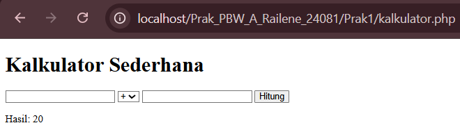

**biodata.php**


## 2. Modifikasi Program Minimal 2

### Modifikasi 1: Hitung Sekali Menjadi Hitung Bertahap

Kalkulator diubah dari hitung sekali menjadi hitung bertahap, menggunakan 3 hidden input (`num1`, `op`, `new_input`). Fungsinya untuk menyimpan memori pada kalkulator.

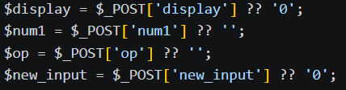

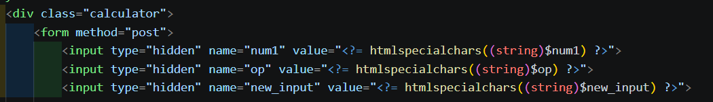

### Modifikasi 2: Operasi Hitung Baru

Menambahkan operasi hitung baru: akar kuadrat (`sqrt`), kuadrat (`sq`), dan modulo (`%`).

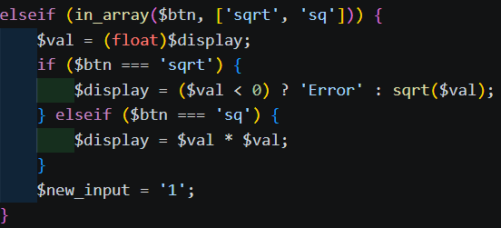

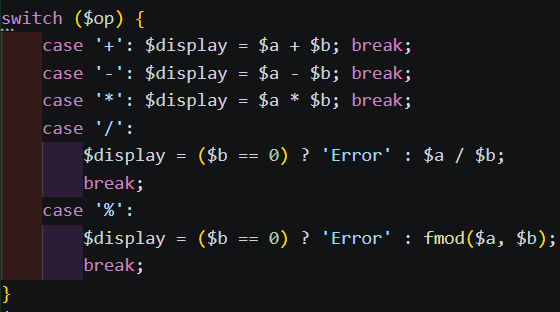

## 3. Penjelasan Bagian Kode yang Paling Penting

Penjelasan singkat lima bagian kode yang paling penting:

### 1. Tiga variabel `num1`, `op`, `new_input` lewat hidden input

Tiga variabel ini ditaruh sebagai hidden input di dalam form, supaya nilai dari kalkulator ikut terkirim ulang saat tombol dipencet. Hal ini diperlukan karena PHP bersifat *stateless*, yaitu server tidak bisa mengingat apa pun dari request sebelumnya.


### 2. Kondisi awal input angka

Kondisi ini menentukan kapan angka baru menimpa layar (kalau layar masih `0`, `Error`, atau habis menekan operator) dan kapan disambung ke angka yang sudah ada. Ada juga pengecekan supaya titik desimal tidak bisa diketik dua kali.

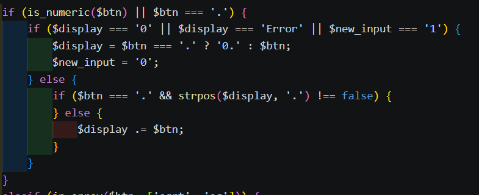

### 3. Akar kuadrat dan kuadrat

Pada akar kuadrat, angka dicek dulu apakah negatif. Angka negatif tidak punya hasil di bilangan real, jadi langsung menghasilkan `Error`. Kuadrat tidak perlu validasi karena hasilnya selalu ada dan tidak mungkin negatif.


### 4. Fungsi `statusKelulusan()`

Parameter dan return value diberi tipe data (`float` masuk, `string` keluar), supaya pengecekan sesuai dengan syarat. Kalau syarat terpenuhi, fungsi langsung `return` dan berhenti.

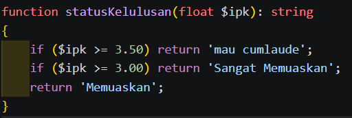

### 5. Penggunaan `htmlspecialchars()`

Semua data ditampilkan lewat `htmlspecialchars()` supaya karakter HTML tidak dibaca sebagai kode. Hal ini mencegah serangan XSS.

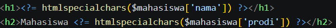

## 4. Tampilan Sebelum dan Sesudah Modifikasi

Berikut perbandingan tampilan program sebelum dan sesudah dilakukan modifikasi.

### 4.1 Tampilan Kalkulator

**a. Sebelum Modifikasi (`kalkulator.php`)**

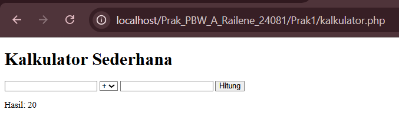

**b. Sesudah Modifikasi (`Kalkulator_Tugas1.php`)**

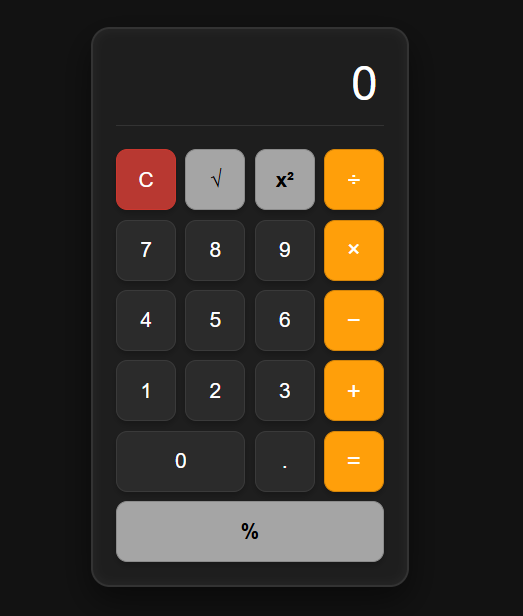

### 4.2 Tampilan Biodata

**a. Sebelum Modifikasi (`biodata.php`)**

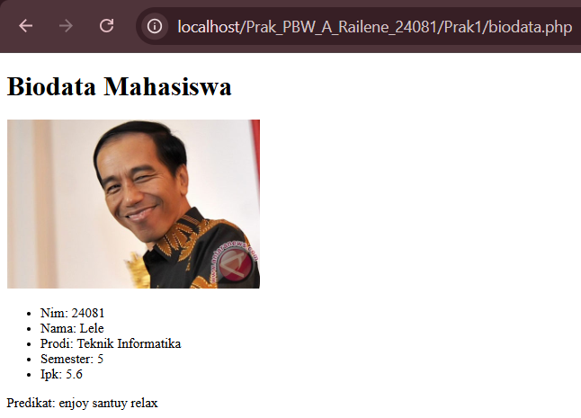

**b. Sesudah Modifikasi (`biodata_tugas1.php`)**

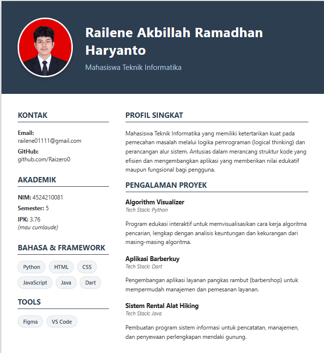

## 5. Error yang Pernah Muncul

Error muncul saat menambahkan tombol `%` (modulo) pada keypad kalkulator. Logika untuk operator ini sebenarnya sudah ada sejak awal di dalam kode, tetapi belum bisa digunakan karena belum ada tombolnya. Saat tombol ditambahkan dan dicoba menghitung angka desimal, misalnya `10.5 % 3`, browser menampilkan peringatan:

```
Deprecated: Implicit conversion from float 10.5 to int loses precision in
C:\laragon\www\Prak_PBW_A_Railene_24081\Prak1\Kalkulator_Tugas1.php on line 48
```

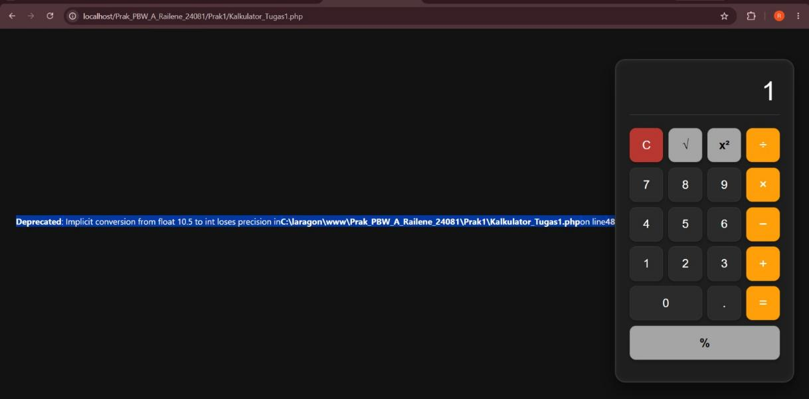

### Penyebab

Operator `%` di PHP dirancang khusus untuk bilangan bulat (*integer*), bukan bilangan desimal (*float*). Saat memasukkan angka desimal seperti `10.5`, PHP otomatis memotongnya menjadi `10` sebelum dihitung modulusnya. Akibatnya hasil di layar adalah `1`, padahal seharusnya `1.5`.

Baris kode sumber masalah, pada `Kalkulator_Tugas1.php` baris 48:

```php
case '%':
    $display = ($b == 0) ? 'Error' : $a % $b;
    break;
```

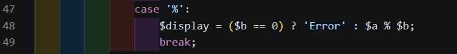

### Perbaikan

Operator `%` diganti dengan fungsi bawaan PHP `fmod()`, yang memang dibuat khusus untuk menghitung modulus pada bilangan desimal tanpa memotong presisinya:

```php
case '%':
    $display = ($b == 0) ? 'Error' : fmod($a, $b);
    break;
```

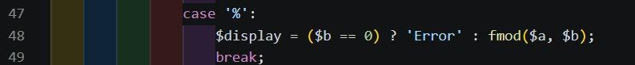

### Hasil Sebelum dan Sesudah Diperbaiki

**Sebelum** (hasil `1` dan muncul peringatan):


**Sesudah** (hasil `1.5`):

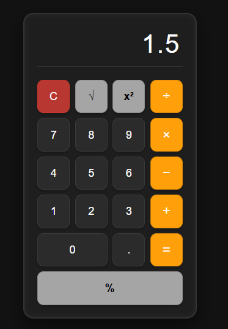

---

# Pertemuan 3

Materi: Instalasi, Konfigurasi, dan Halaman Pertama Laravel 12 (Arsitektur MVC, HTTP Request Lifecycle, Routing `routes/web.php`, dan Templating Blade `resources/views/`).

Proyek Utama: **LaraPress** (Aplikasi Blog Sederhana)

---

## 1. Cara Install Laravel

Susunan instalasi dan konfigurasi proyek disesuaikan dengan Modul Praktikum PBW Pertemuan 3:

### Kebutuhan Sistem & Environment

| Perangkat / Software | Standar Versi | Fungsi Utama |
| --- | --- | --- |
| **PHP** | Minimal Versi 8.2 | Programming Language Runtime |
| **Web Server & DB** | Laragon / XAMPP | Environment Web Server (Apache) & MySQL |
| **Dependency Manager** | Composer 2.x | Pustaka Manajer Dependensi PHP |
| **Terminal / CLI** | Terminal Laragon / CMD / Git Bash | Eksekutor perintah CLI Artisan & Composer |
| **Code Editor** | Visual Studio Code | Penyuntingan & pengelolaan kode sumber |
| **Web Browser** | Google Chrome / Firefox / Brave | Pengujian tampilan aplikasi web |

### Langkah-Langkah Instalasi Proyek LaraPress

1. **Membuat Proyek Baru via Composer**  
   Buka terminal pada root server web (`C:\laragon\www\` atau `C:\xampp\htdocs\`), lalu jalankan perintah:
   ```bash
   composer create-project laravel/laravel:"^12.0" LaraPress
   ```

2. **Masuk ke Direktori Proyek**  
   Pindahkan direktori aktif terminal ke folder proyek:
   ```bash
   cd LaraPress
   ```

3. **Konfigurasi Environment & Generate Application Key**  
   Salin file konfigurasi environment `.env` dan buat kunci enkripsi aplikasi:
   ```bash
   copy .env.example .env
   php artisan key:generate
   ```

4. **Menjalankan Development Server Lokal**  
   Jalankan server lokal bawaan Artisan:
   ```bash
   php artisan serve
   ```
   Aplikasi akan berjalan di alamat: `http://127.0.0.1:8000`

---

## 2. Tugas yang Dikerjakan

Berdasarkan Modul Praktikum Pertemuan 3, tugas yang diselesaikan meliputi dua bagian:

1. **Tugas Utama**:
   - Membangun proyek baru berbasis Laravel 12 bernama **LaraPress**.
   - Mendefinisikan rute utama `/` pada `routes/web.php` yang mengembalikan tampilan View Halaman Utama (`welcome.blade.php`).
   - Mendefinisikan rute `/tentang-kami` pada `routes/web.php` yang mengembalikan tampilan View Halaman Tentang Kami (`about.blade.php`).
   - Menghubungkan kedua halaman statis tersebut menggunakan link navigasi bolak-balik (`<a href="...">`).

2. **Tugas Mandiri (Wajib)**:
   - Membuat satu halaman statis baru bernama **Kontak**.
   - Mendefinisikan endpoint rute `/kontak` pada `routes/web.php` yang memanggil View `contact.blade.php`.
   - Mengisi halaman kontak dengan informasi kontak pengembang yang relevan dan menambahkan tautan navigasi ke halaman lainnya.

---

## 3. Fitur-Fitur Utama

Berikut adalah fitur-fitur yang ada pada aplikasi web LaraPress di Pertemuan 3:

* **Halaman Utama / Landing Page (`/`)**: Menampilkan banner ucapan selamat datang, deskripsi singkat platform LaraPress, 3 kartu highlight modul (MVC, Breeze, Blade), serta tombol direct link menuju repositori GitHub proyek.
* **Halaman Tentang Kami (`/tentang-kami`)**: Menampilkan informasi tujuan pengembangan proyek, teknologi yang digunakan (*tech stack*), environment server, serta kartu profil pengembang (Nama, NPM, Prodi, dan Kampus).
* **Halaman Hubungi Kami (`/kontak`)**: Menampilkan kartu informasi email *support*, lokasi kampus, serta tombol aksi interaktif *Direct Chat WhatsApp* yang langsung terhubung ke nomor WhatsApp pengembang (`+62 896-5630-2791`).
* **Navigasi Bar & Footer Konsisten**: Menyediakan menu navigasi yang konsisten di setiap halaman serta deteksi tombol status login/register.
* **Antarmuka Modern & Responsif**: Menggunakan Tailwind CSS dengan gaya *dark mode*, warna aksen neon cyan & indigo, serta efek tampilan *glassmorphism*.

---

## 4. Hasil Foto Tugas 3

Berikut adalah hasil tangkapan layar antarmuka proyek LaraPress pada Pertemuan 3:

### 4.1 Halaman Utama (`/`)

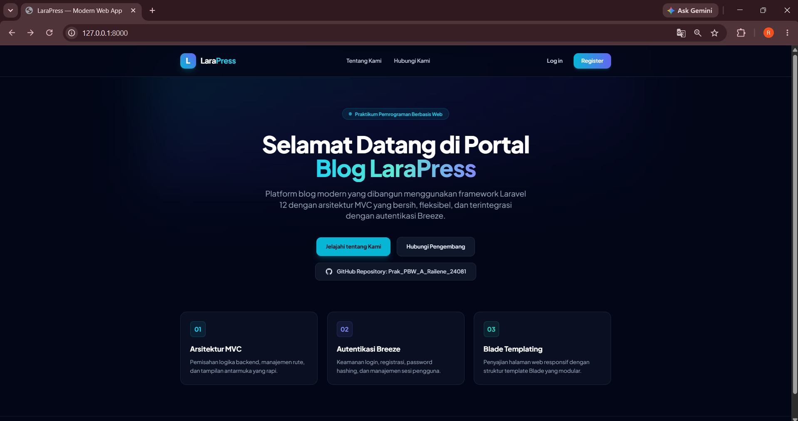

### 4.2 Halaman Tentang Kami (`/tentang-kami`)

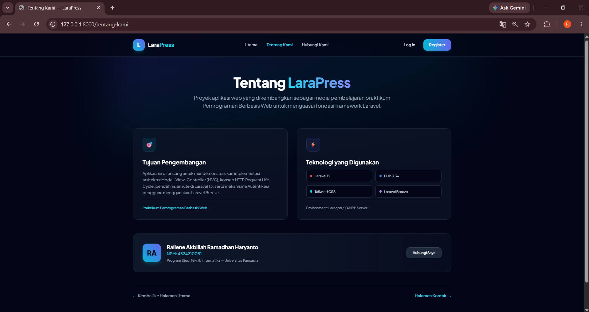

### 4.3 Halaman Hubungi Kami (`/kontak`)

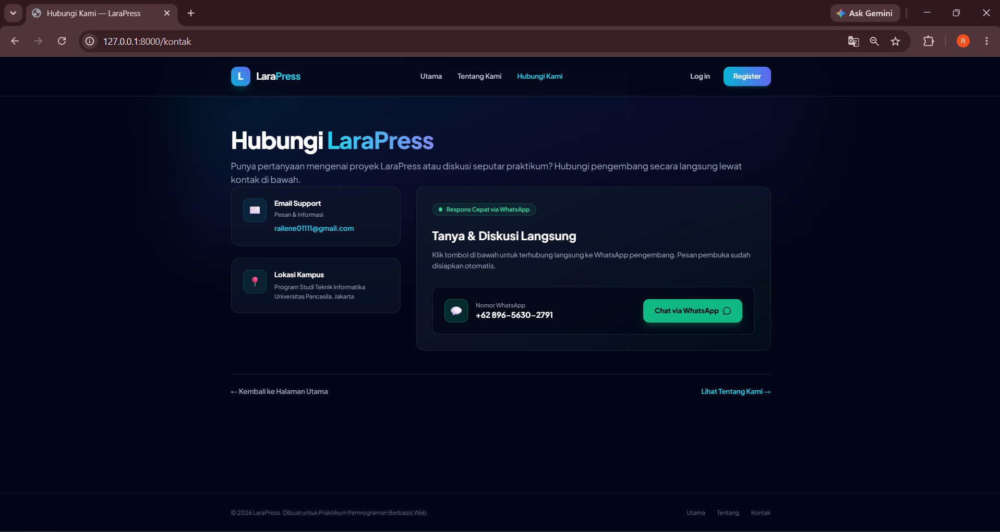

---

# Pertemuan 4 (Tugas 4)

Materi : Authentikasi Login

Proyek Utama: **LaraPress**

---

## 1. Cara Install Laravel Breeze

Susunan instalasi dan konfigurasi sistem autentikasi disesuaikan dengan Modul Praktikum PBW Pertemuan 4:

### Kebutuhan Sistem & Environment

| Perangkat / Package | Standar Versi | Fungsi Utama |
| --- | --- | --- |
| **PHP** | Minimal Versi 8.2 | Programming Language Runtime |
| **Framework** | Laravel 12.x | Framework Utama Aplikasi Web |
| **Starter Kit** | Laravel Breeze | Package Starter Kit Autentikasi |
| **Database Engine** | MySQL / MariaDB (Laragon / XAMPP) | Penyimpanan Tabel Users & Sessions |
| **Frontend Tooling** | Node.js & NPM (Tailwind CSS) | Asset Bundler & Styling Frontend |

### Langkah-Langkah Instalasi Laravel Breeze

1. **Masuk ke Direktori Proyek LaraPress**  
   Buka terminal, lalu arahkan aktif terminal ke folder proyek `LaraPress`:
   ```bash
   cd LaraPress
   ```

2. **Instalasi Package Laravel Breeze via Composer**  
   Unduh pustaka dependensi Breeze ke dalam proyek:
   ```bash
   composer require laravel/breeze --dev
   ```

3. **Eksekusi Command Artisan Breeze Install**  
   Publikasikan komponen Controllers, Views, dan Routes bawaan Breeze:
   ```bash
   php artisan breeze:install
   ```
   *Pilihan Konfigurasi CLI:*
   - Stack pilihan: `Blade with Alpine` (Pilih 0)
   - Dark mode support: `No`
   - Testing framework: `Pest` (Pilih 0)

4. **Instalasi Dependensi Frontend & Compiling Assets**  
   Instal pustaka JavaScript/Tailwind dan lakukan kompilasi aset:
   ```bash
   npm install
   npm run dev
   ```

5. **Jalankan Migrasi Database**  
   Eksekusi migrasi untuk membuat tabel `users`, `password_reset_tokens`, dan `sessions`:
   ```bash
   php artisan migrate
   ```

6. **Menjalankan Development Server Lokal**  
   Jalankan server Artisan bawaan Laravel:
   ```bash
   php artisan serve
   ```
   Aplikasi dan rute autentikasi akan aktif di alamat: `http://127.0.0.1:8000`

---

## 2. Tugas yang Dikerjakan

Berdasarkan Modul Praktikum Pertemuan 4, tugas yang diselesaikan meliputi empat bagian utama:

1. **Memahami Konsep & Filosofi Autentikasi**:
   - Memahami perbedaan Autentikasi ("Siapa Anda?") dan Otorisasi ("Apa yang boleh dilakukan?").
   - Memahami mekanisme Password Hashing (Bcrypt) satu arah dan proteksi CSRF (`@csrf`).
   - Memahami peran Cookies dan Sessions sebagai penanda status login pengguna pada protokol HTTP yang *stateless*.

2. **Instalasi & Konfigurasi Laravel Breeze**:
   - Mengintegrasikan package Laravel Breeze ke dalam aplikasi blog **LaraPress**.
   - Menjalankan migrasi struktur database pendukung autentikasi.

3. **Mengamankan Rute Terproteksi dengan Middleware `auth`**:
   - Mendaftarkan rute terproteksi untuk `/dashboard` dan grup rute `/profile` di file `routes/web.php`.
   - Menguji pengalihan otomatis (*redirect*) pengguna yang belum terautentikasi kembali ke halaman `/login`.

4. **Kustomisasi UI & Antarmuka Modern**:
   - Merombak tampilan bawaan Breeze (`login.blade.php`, `register.blade.php`, `dashboard.blade.php`, dan `edit.blade.php` profil) agar serasi dengan antarmuka LaraPress berbasis Tailwind CSS *dark mode*, aksen neon cyan & indigo, serta efek *glassmorphism*.

---

## 3. Fitur-Fitur Utama

Berikut adalah fitur-fitur utama sistem autentikasi pada aplikasi LaraPress di Pertemuan 4:

* 🔑 **Autentikasi Registrasi & Login**: Menyediakan form registrasi akun baru dan form login dengan validasi kredensial email & password.
* 🛡️ **Keamanan Password Hashing & CSRF**: Password terenkripsi secara otomatis menggunakan algoritma hashing Bcrypt, serta seluruh form terlindungi token `@csrf`.
* 🚧 **Proteksi Rute Middleware (`auth`)**: Mengunci rute khusus seperti `/dashboard` dan `/profile` agar tidak bisa diakses langsung tanpa sesi login yang valid.
* 👤 **Dashboard Admin Interaktif**: Menampilkan panel pusat kendali administrator terproteksi yang menampilkan ucapan selamat datang dinamis (`Auth::user()->name`) dan status akun terdaftar.
* ⚙️ **Pengelolaan Profil & Keamanan Akun**: Menyediakan halaman khusus bagi pengguna terautentikasi untuk mengedit informasi nama, email, mengubah kata sandi, serta menghapus akun.
* 🎨 **Antarmuka Modern Dark Mode**: Tampilan terintegrasi penuh menggunakan Tailwind CSS dengan efek *glassmorphism*, font Plus Jakarta Sans, dan warna aksen neon cyan & indigo.

---

## 4. Hasil Foto Tugas 4

Berikut adalah hasil tangkapan layar antarmuka sistem autentikasi LaraPress pada Pertemuan 4:

### 4.1 Halaman Login (`/login`)

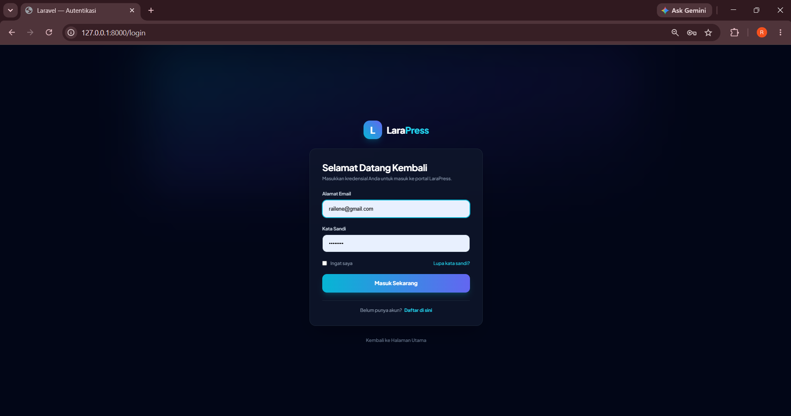

### 4.2 Halaman Registrasi (`/register`)

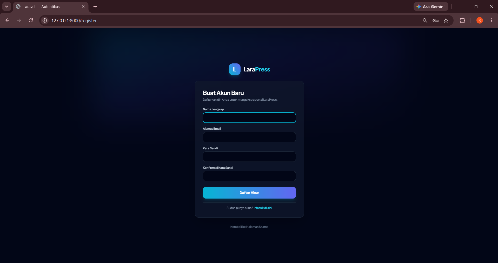

### 4.3 Halaman Dashboard Admin (`/dashboard`)

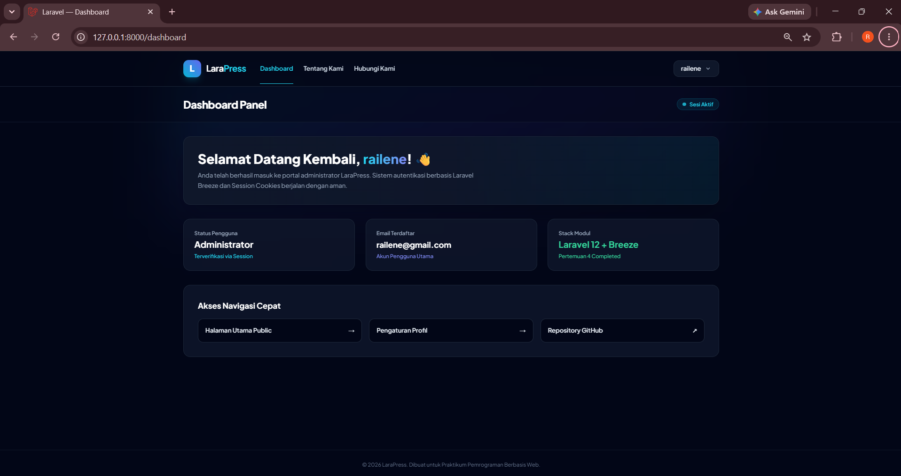

### 4.4 Halaman Pengaturan Profil (`/profile`)

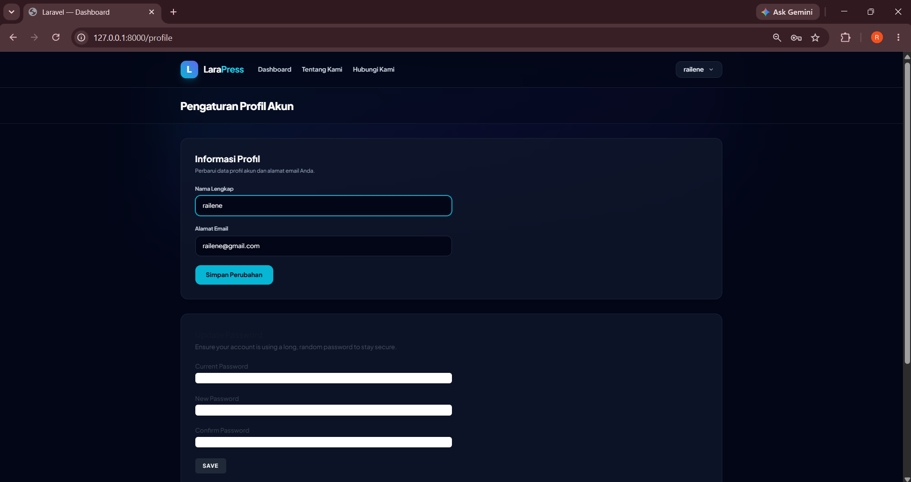

---

# Pertemuan 5

*Laporan menyusul.*

---
